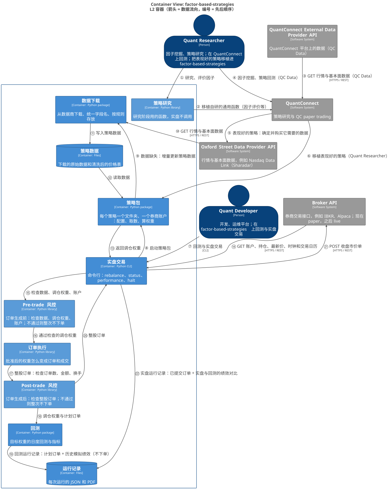

# factor-based-strategies

因子策略研究项目。研究方法见 [research_spec.md](research_spec.md)，各章节对应的代码文件见 [architecture.md](architecture.md)。

## 架构（C4）

图由 [docs/architecture/workspace.dsl](docs/architecture/workspace.dsl)（Structurizr DSL）生成。改图只改这个文件，然后运行 `make diagrams` 重新生成 `docs/architecture/` 下的 SVG。每往下一层，就到对应文件夹的 README 里看。设计细节见 [architecture_new.md](architecture_new.md)。

### L1 系统上下文


Quant Researcher 在本系统里研究因子，并把自研的通用函数移植到 QuantConnect；在 QuantConnect 上用 QC Data 做因子挖掘和策略回测，表现好的策略购买 Oxford Street 的数据，由 Quant Researcher 移植到 `strategy/`。两种回测分工不同：Quant Researcher 负责 QuantConnect 上的回测，Quant Developer 负责本系统上的回测与实盘交易（Alpaca）。

### L2 容器



箭头表示数据流向，编号是先后顺序：① 在本系统研究、评价因子 → ② 把自研的通用函数移植到 QuantConnect → ③ QuantConnect 取 QC Data → ④ 在 QuantConnect 做因子挖掘、策略回测 → ⑤ 表现好的策略购买数据 → ⑥ 移植策略 → ⑦ Quant Developer 做回测与实盘交易 → ⑧ 启动策略包 → ⑨–⑫ 缺数据时增量下载、写入、读取 → ⑬ 返回调仓权重 → ⑭ GET 账户和持仓 → ⑮ Pre-trade 风控检查数据、调仓权重、账户 → ⑯ 通过检查的调仓权重进入订单执行 → ⑰ 整股订单进入 Post-trade 风控 → ⑱ 调仓权重与计划订单进入回测 → ⑲ 回测运行记录（计划订单 + 历史模拟绩效，不下单）→ ⑳ 整股订单回到实盘交易 → ㉑ POST 订单 → ㉒ 实盘运行记录（已提交订单 + 实盘与回测的绩效对比）。L1 图上的编号和这里一致。API 箭头：GET 从 API 指向读取方，POST 从发送方指向 API。

### 各容器的 README

| 容器 | 类型 | 代码 | L3 / L4 在哪看 |
| --- | --- | --- | --- |
| 策略包 | 每个策略一个，被 live 和回测加载 | `strategy/{name}/` | [strategy/README.md](strategy/README.md) |
| 数据下载 | 由策略的 data.py 调用 | `src/fbs/etl/` | [src/fbs/etl/README.md](src/fbs/etl/README.md) |
| 回测 | 被 live 的报告调用 | `src/fbs/backtesting/` | [src/fbs/backtesting/README.md](src/fbs/backtesting/README.md) |
| 实盘交易 | 命令行，AWS 上定时运行 | `src/fbs/live/` | [src/fbs/live/README.md](src/fbs/live/README.md)（含一次 rebalance 的流程图和 AWS 部署图） |
| 风控 | 共享库 | `src/fbs/risk/` | [src/fbs/risk/README.md](src/fbs/risk/README.md) |
| 订单执行 | 共享库 | `src/fbs/execution/` | [src/fbs/execution/README.md](src/fbs/execution/README.md) |
| 策略研究 | 研究用的函数库 | `src/fbs/research/` | [src/fbs/research/README.md](src/fbs/research/README.md) |

图中灰色虚线的框和箭头是已经设计、还没实现的部分（architecture_new.md §5.15）。

### 准备

根据系统选一种，按顺序执行。

依赖由 [uv](https://docs.astral.sh/uv/) 管理：[pyproject.toml](pyproject.toml) 声明需要哪些包，[uv.lock](uv.lock) 锁定每个包的确切版本，所以每个人装出来的环境完全一样。Python 3.12 也由 uv 自动下载，不需要自己装。

#### macOS / Linux

```bash
# 0. 安装 uv（只需一次）
brew install uv          # 没有 Homebrew 时：curl -LsSf https://astral.sh/uv/install.sh | sh

# 1. 按 uv.lock 创建虚拟环境 .venv，安装 fbs 包和全部依赖（含 live 下单依赖）
make install

# 2. 生成 .env，再打开 .env 填入 API key（等号两边不要有空格）
make env

# 3. 启动后端
make api
```

#### Windows

在 VS Code 里按 `` Ctrl+` `` 打开终端，默认就是 PowerShell。

```powershell
# 0. 安装 uv（只需一次），装完重开终端
powershell -ExecutionPolicy ByPass -c "irm https://astral.sh/uv/install.ps1 | iex"

# 1. 按 uv.lock 创建虚拟环境 .venv，安装 fbs 包和全部依赖（含 live 下单依赖）
uv sync --locked --extra live

# 2. 生成 .env
if (Test-Path .env) { ".env already exists, left unchanged" } else { Set-Content .env "NASDAQ_DATA_LINK_API_KEY=" -Encoding ascii }

# 3. 打开 .env 填入 API key（等号两边不要有空格）

# 4. 启动后端
.venv\Scripts\uvicorn fbs.api.main:app --app-dir src --env-file .env --host 127.0.0.1 --port 8000 --reload
```

不需要激活虚拟环境（`activate`），直接用 `.venv\Scripts\` 下的程序即可，这样也避开了 PowerShell 默认禁止运行脚本的限制。

第 4 步启动后，打开 http://127.0.0.1:8000/docs 可以看到全部接口(按 Ctrl+C 停止) 

**下载数据只用 `POST /api/downloads` 这一个接口。** 步骤：

1. 展开 `downloads` 下的 `POST /api/downloads`，点 **Try it out**
2. Request body 里已经填好一个能直接运行的模板（SPY 在 2024 年 1 月的 SFP 日线），按需要修改后点 **Execute**：

   ```json
   {
     "product": "fund_prices",
     "table": "SFP",
     "filters": {"ticker": "SPY", "date": {"gte": "2024-01-01", "lte": "2024-01-31"}}
   }
   ```

3. 返回结果里有 `job_id`。用 `GET /api/downloads/{job_id}` 查进度：`status` 变成 `done` 后，`path` 就是文件位置

请求参数：

| 参数 | 是否必填 | 含义 | 取值 |
|---|---|---|---|
| `product` | 必填 | 产品 | `core_us_fundamentals`、`core_us_insiders`、`core_us_institutional_investors`、`equity_prices`、`fund_prices` 五个之一 |
| `table` | 必填 | 表代码，必须属于 `product` | `GET /api/tables` 列出每个产品有哪些表；各表的含义见 [data/data_library.md](data/data_library.md) |
| `filters` | 选填 | 按列过滤，不填就是下载整张表 | 只有可过滤列能用，见 `GET /api/tables/{table}/schema` 返回的 `filters` |
| `columns` | 选填 | 只下载这些列，不填就是全部列 | `GET /api/tables/{table}/schema` 返回的 `columns` |
| `overwrite` | 选填，默认 `false` | 当天已经下载过同样的文件时，是否重新下载 | `true` / `false` |

`filters` 中每一列的值有三种写法：

| 写法 | 例子 |
|---|---|
| 单个值 | `"ticker": "SPY"` |
| 多个值 | `"ticker": ["SPY", "QQQ"]` |
| 范围，可用 `gt`、`gte`、`lt`、`lte`，日期写成 `YYYY-MM-DD` | `"date": {"gte": "2024-01-01", "lte": "2024-01-31"}` |


## 常用命令

`make help` 列出全部命令。

| 命令 | 作用 |
|---|---|
| `make install` | 按 `uv.lock` 创建或同步 `.venv`，装上 fbs 包和全部依赖；pull 到新的 `uv.lock` 后再跑一次即可同步 |
| `uv add 包名` | 新增依赖：同时改 `pyproject.toml` 和 `uv.lock`，两个文件一起提交 |
| `make lock` | 手动改了 `pyproject.toml` 后，重新生成 `uv.lock` |
| `make upgrade` | 把所有包升级到允许范围内的最新版，重写 `uv.lock` 并同步 `.venv` |
| `make env` | 生成只含 `NASDAQ_DATA_LINK_API_KEY=` 一行的 `.env`，已存在时不覆盖 |
| `make api` | 启动后端，修改代码后自动重启，只能本机访问 |
| `make api-prod` | 启动后端，不自动重启，其他机器也能访问（部署用） |
| `make api PORT=9000` | 换端口启动 |
| `make clean-bronze` | 删除 `data/bronze/` 中的全部下载数据，执行前需要输入 `y` 确认 |
| `make clean` | 删除 `.venv` 和构建产物，之后需要重新 `make install` |

Windows 下对应的 PowerShell 命令：

| 对应 | PowerShell 命令 |
|---|---|
| `make install` | `uv sync --locked --extra live` |
| `make lock` | `uv lock` |
| `make upgrade` | `uv lock --upgrade`，再 `uv sync --locked --extra live` |
| `make env` | `if (Test-Path .env) { ".env already exists, left unchanged" } else { Set-Content .env "NASDAQ_DATA_LINK_API_KEY=" -Encoding ascii }` |
| `make api` | `.venv\Scripts\uvicorn fbs.api.main:app --app-dir src --env-file .env --host 127.0.0.1 --port 8000 --reload` |
| `make api-prod` | `.venv\Scripts\uvicorn fbs.api.main:app --app-dir src --env-file .env --host 0.0.0.0 --port 8000` |
| `make api PORT=9000` | 把 `make api` 那条命令里的 `--port 8000` 改成 `--port 9000` |
| `make clean-bronze` | `if ((Read-Host "Delete everything in data/bronze? [y/N]") -eq 'y') { Get-ChildItem data\bronze \| Remove-Item -Recurse -Force }` |
| `make clean` | `Remove-Item -Recurse -Force .venv, build, dist, src\*.egg-info -ErrorAction SilentlyContinue`，再 `Get-ChildItem -Recurse -Directory -Filter __pycache__ \| Remove-Item -Recurse -Force` |

## 目录

| 目录 | 内容 |
|---|---|
| `src/fbs/etl/` | 数据下载：提取、变换、存储（[README](src/fbs/etl/README.md)） |
| `src/fbs/factor/` | 因子算子 |
| `src/fbs/sample/` | 样本构建：前向收益等 |
| `src/fbs/backtesting/` | 回测（[README](src/fbs/backtesting/README.md)） |
| `src/fbs/live/` | 实盘交易：Alpaca paper trading（[README](src/fbs/live/README.md)） |
| `src/fbs/risk/` | 风控（[README](src/fbs/risk/README.md)） |
| `src/fbs/execution/` | 执行：调仓日、订单（[README](src/fbs/execution/README.md)） |
| `src/fbs/research/` | 策略研究：`eval/` 因子评价、`combination_factor/` 因子组合（[README](src/fbs/research/README.md)） |
| `strategy/` | 每个策略一个文件夹（[README](strategy/README.md)） |
| `docs/architecture/` | C4 架构图：`workspace.dsl` 和生成的 SVG |
| `data/bronze/`、`data/silver/`、`data/gold/` | 原始数据、中间数据、清洗数据，只保存在本地 |
