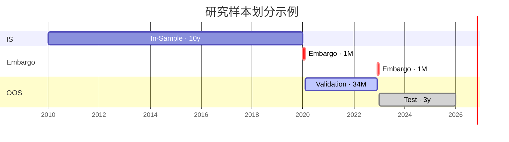

# Research Spec

**版本**：v0.2

**日期**：2026-10-15

**描述**：本文档作为我们量化因子策略研究流程的通用说明书，它按模块说明每个环节研究的规则与方法。表述不绑定具体市场，适用于股票与 FICC（固定收益、外汇、大宗商品）。

M 代表研究模块（module）。

> 写作约定：
> - **表格**：属性统一、每格一个短语、用于查找和对照的信息，如资产类别与数据、样本分区及用途

> - **分点**：带条件、步骤或原因的规则与方法

> - **编号列表**：有先后顺序的步骤，如模型训练

> - **段落**：只讲一件事、前后逻辑连贯的定义或说明，如各节开头的定义

> - **标点**：列表项末尾不加句号，段落末尾加句号。

---
## M0. 研究框架

<table>
   <thead>
      <tr>
         <th nowrap>模块</th>
         <th nowrap>名称</th>
         <th nowrap>小节</th>
         <th nowrap>子小节</th>
      </tr>
   </thead>
   <tbody>
      <tr>
         <td nowrap rowspan="3"><a href="#m1-数据etl">M1</a></td>
         <td nowrap rowspan="3"><a href="#m1-数据etl">数据ETL</a></td>
         <td nowrap><a href="#m11-数据提取">M1.1 数据提取</a></td>
         <td nowrap><a href="#m111-原始数据">M1.1.1 原始数据</a> <a href="#m112-数据源">M1.1.2 数据源</a></td>
      </tr>
      <tr>
         <td nowrap><a href="#m12-数据变换transform">M1.2 数据变换（Transform）</a></td>
         <td nowrap><a href="#m121-标准化">M1.2.1 标准化</a> <a href="#m122-标识符">M1.2.2 标识符</a>（<a href="#m1221-标识符定义">M1.2.2.1</a> · <a href="#m1222-映射表">M1.2.2.2</a> · <a href="#m1223-标识符设置">M1.2.2.3</a>） <a href="#m123-形态特有处理">M1.2.3 形态特有处理</a> <a href="#m124-数据对齐">M1.2.4 数据对齐</a>（<a href="#m1241-数据修订">M1.2.4.1</a> · <a href="#m1242-收盘价次日才可知">M1.2.4.2</a> · <a href="#m1243-参考期与发布日不同">M1.2.4.3</a>） <a href="#m125-去重">M1.2.5 去重</a></td>
      </tr>
      <tr>
         <td nowrap><a href="#m13-数据存储loading">M1.3 数据存储（Loading）</a></td>
         <td nowrap><a href="#m131-本地云端存储">M1.3.1 本地/云端存储</a> <a href="#m132-loading-文件格式">M1.3.2 Loading 文件格式</a> <a href="#m133-数据字典格式">M1.3.3 数据字典格式</a> <a href="#m134-研究样本划分is--oos">M1.3.4 研究样本划分（IS + OOS）</a></td>
      </tr>
      <tr>
         <td nowrap rowspan="3"><a href="#m2-因子公式构建与入库">M2</a></td>
         <td nowrap rowspan="3"><a href="#m2-因子公式构建与入库">因子公式构建与入库</a></td>
         <td nowrap><a href="#m21-因子库分类">M2.1 因子库分类</a></td>
         <td nowrap>—</td>
      </tr>
      <tr>
         <td nowrap><a href="#m22-因子公式构建">M2.2 因子公式构建</a></td>
         <td nowrap>—</td>
      </tr>
      <tr>
         <td nowrap><a href="#m23-因子入库规范">M2.3 因子入库规范</a></td>
         <td nowrap><a href="#m231-因子库位置">M2.3.1 因子库位置</a> <a href="#m232-因子主题代码">M2.3.2 因子主题代码</a> <a href="#m233-因子卡片必填信息">M2.3.3 因子卡片必填信息</a></td>
      </tr>
      <tr>
         <td nowrap rowspan="6"><a href="#m3-因子研究与因子评价">M3</a></td>
         <td nowrap rowspan="6"><a href="#m3-因子研究与因子评价">因子研究与因子评价</a></td>
         <td nowrap><a href="#m31-基础频率">M3.1 基础频率</a></td>
         <td nowrap>—</td>
      </tr>
      <tr>
         <td nowrap><a href="#m32-因子值">M3.2 因子值</a></td>
         <td nowrap>—</td>
      </tr>
      <tr>
         <td nowrap><a href="#m33-未来收益率">M3.3 未来收益率</a></td>
         <td nowrap>—</td>
      </tr>
      <tr>
         <td nowrap><a href="#m34-因子评价指标">M3.4 因子评价指标</a></td>
         <td nowrap>—</td>
      </tr>
      <tr>
         <td nowrap><a href="#m35-样本内划分">M3.5 样本内划分</a></td>
         <td nowrap>—</td>
      </tr>
      <tr>
         <td nowrap><a href="#m36-指标范围">M3.6 指标范围</a></td>
         <td nowrap>—</td>
      </tr>
      <tr>
         <td nowrap rowspan="8"><a href="#m4-因子组合">M4</a></td>
         <td nowrap rowspan="8"><a href="#m4-因子组合">因子组合</a></td>
         <td nowrap><a href="#m41-因子综合评分">M4.1 因子综合评分</a></td>
         <td nowrap>—</td>
      </tr>
      <tr>
         <td nowrap><a href="#m42-因子选择">M4.2 因子选择</a></td>
         <td nowrap>—</td>
      </tr>
      <tr>
         <td nowrap><a href="#m43-因子值标准化">M4.3 因子值标准化</a></td>
         <td nowrap>—</td>
      </tr>
      <tr>
         <td nowrap><a href="#m44-未来收益率调整">M4.4 未来收益率调整</a></td>
         <td nowrap>—</td>
      </tr>
      <tr>
         <td nowrap><a href="#m45-模型选择">M4.5 模型选择</a></td>
         <td nowrap>—</td>
      </tr>
      <tr>
         <td nowrap><a href="#m46-数据处理">M4.6 数据处理</a></td>
         <td nowrap>—</td>
      </tr>
      <tr>
         <td nowrap><a href="#m47-模型训练">M4.7 模型训练</a></td>
         <td nowrap>—</td>
      </tr>
      <tr>
         <td nowrap><a href="#m48-模型检验">M4.8 模型检验</a></td>
         <td nowrap>—</td>
      </tr>
      <tr>
         <td nowrap rowspan="2"><a href="#m5-策略与仓位">M5</a></td>
         <td nowrap rowspan="2"><a href="#m5-策略与仓位">策略与仓位</a></td>
         <td nowrap><a href="#m51-目标持仓构建">M5.1 目标持仓构建</a></td>
         <td nowrap>—</td>
      </tr>
      <tr>
         <td nowrap><a href="#m52-组合中性">M5.2 组合中性</a></td>
         <td nowrap>—</td>
      </tr>
      <tr>
         <td nowrap rowspan="2"><a href="#m6-风险与成本">M6</a></td>
         <td nowrap rowspan="2"><a href="#m6-风险与成本">风险与成本</a></td>
         <td nowrap><a href="#m61-交易成本">M6.1 交易成本</a></td>
         <td nowrap>—</td>
      </tr>
      <tr>
         <td nowrap><a href="#m62-风险控制">M6.2 风险控制</a></td>
         <td nowrap>—</td>
      </tr>
      <tr>
         <td nowrap rowspan="2"><a href="#m7-回测与执行">M7</a></td>
         <td nowrap rowspan="2"><a href="#m7-回测与执行">回测与执行</a></td>
         <td nowrap><a href="#m71-执行假设">M7.1 执行假设</a></td>
         <td nowrap>—</td>
      </tr>
      <tr>
         <td nowrap><a href="#m72-策略回测与评价">M7.2 策略回测与评价</a></td>
         <td nowrap>—</td>
      </tr>
      <tr>
         <td nowrap><a href="#m8-实盘模拟">M8</a></td>
         <td nowrap><a href="#m8-实盘模拟">实盘模拟</a></td>
         <td nowrap><a href="#m81-滚动训练">M8.1 滚动训练</a></td>
         <td nowrap>—</td>
      </tr>
      <tr>
         <td nowrap><a href="#m9-已知局限和待解决问题">M9</a></td>
         <td nowrap><a href="#m9-已知局限和待解决问题">已知局限和待解决问题</a></td>
         <td nowrap>—</td>
         <td nowrap>—</td>
      </tr>
   </tbody>
</table>

产出一套截面因子策略研究工作流：从确认资产集，到因子发现与评价，再到因子建模，最终将因子变成可交易的策略。

---
## M1. 数据ETL

本节分为三部分：
M1.1 定义数据提取；
M1.2 定义数据变换；
M1.3 定义数据存储。

### M1.1 数据提取

数据提取指通过网页下载或 API 从数据源获取原始数据，原样保存，不做任何修改。

#### M1.1.1 原始数据

原始数据统一分为两级：一级为资产类别，二级为工具类型。

<table>
   <thead>
      <tr>
         <th nowrap>一级资产类别</th>
         <th nowrap>代码</th>
         <th nowrap>二级工具类型</th>
      </tr>
   </thead>
   <tbody>
      <tr>
         <td nowrap>股票</td>
         <td nowrap><code>EQ</code></td>
         <td nowrap>现货 <code>spot</code>、衍生品 <code>derivative</code></td>
      </tr>
      <tr>
         <td nowrap>固定收益</td>
         <td nowrap><code>FI</code></td>
         <td nowrap>现货 <code>spot</code>、衍生品 <code>derivative</code></td>
      </tr>
      <tr>
         <td nowrap>外汇</td>
         <td nowrap><code>FX</code></td>
         <td nowrap>现货 <code>spot</code>、衍生品 <code>derivative</code></td>
      </tr>
      <tr>
         <td nowrap>大宗商品</td>
         <td nowrap><code>CM</code></td>
         <td nowrap>衍生品 <code>derivative</code></td>
      </tr>
   </tbody>
</table>

#### M1.1.2 数据源
每个数据源在 `data/README.md` 中登记一张卡片，卡片包含以下字段：
- **一级资产类别**
- **二级工具类型**
- **数据接口**：API 名称或下载方式
- **可下载字段**：接口返回的字段列表
- **数据频率**：数据的发布频率
- **可用时间**：数据最早可用于决策的时点
- **是否修订**：数据源是否会回溯修订已发布的值
- **是否提供历史版本**：数据源是否保留每个修订版本及其发布时间

### M1.2 数据变换

收益数据与特征数据共用一条 pipeline，依次执行

#### M1.2.1 标准化
- **时间**：统一为 UTC。
- **单位**：统一表格内计价货币、百分比 / 基点、数量单位等。
- **列名**：数据源原始列名映射为 <a href="#m132-loading-文件格式">M1.3.2</a> 的标准列名，如 EODHD 的 `Date` → `date`。
- **查询键**：每行保留以下四个查询键，供 <a href="#m1223-标识符设置">M1.2.2.3</a> 标识符设置比对：

<table>
   <thead>
      <tr>
         <th nowrap>查询键</th>
         <th nowrap>数据类型</th>
         <th nowrap>作用</th>
         <th nowrap>格式</th>
      </tr>
   </thead>
   <tbody>
      <tr>
         <td nowrap><code>source</code></td>
         <td nowrap>收益数据 / 特征数据</td>
         <td nowrap>标明数据来源</td>
         <td nowrap><a href="#m112-数据源">M1.1.2</a> 登记的数据源名称，如 <code>EODHD</code></td>
      </tr>
      <tr>
         <td nowrap><code>source_code</code></td>
         <td nowrap>收益数据</td>
         <td nowrap><a href="#m1223-标识符设置">M1.2.2.3</a> 单数据源收益数据设置标识符</td>
         <td nowrap>数据源中原始标的代码</td>
      </tr>
      <tr>
         <td nowrap><code>source_field</code></td>
         <td nowrap>特征数据</td>
         <td nowrap><a href="#m1223-标识符设置">M1.2.2.3</a> 单数据源特征数据设置标识符</td>
         <td nowrap>数据源中原始字段名</td>
      </tr>
      <tr>
         <td nowrap><code>global_id</code></td>
         <td nowrap>收益数据 / 特征数据</td>
         <td nowrap><a href="#m1223-标识符设置">M1.2.2.3</a> 跨数据源设置标识符</td>
         <td nowrap>按标的类别： 股票 <code>EQ</code>、固定收益 <code>FI</code>：ISIN 外汇 <code>FX</code>：ISO 4217 货币对 大宗商品 <code>CM</code>：待定 经济体 <code>MKT</code>：ISO 3166 国家代码</td>
      </tr>
   </tbody>
</table>

#### M1.2.2 标识符

##### M1.2.2.1 标识符定义

Loading表格 **收益数据** 每行唯一主键:  `date × instrument_id`

Loading表格 **特征数据 **每行唯一主键:  `date × instrument_id × field_id`

<table>
   <thead>
      <tr>
         <th nowrap>标识符</th>
         <th nowrap>作用</th>
         <th nowrap>格式</th>
      </tr>
   </thead>
   <tbody>
      <tr>
         <td nowrap><code>instrument_id</code></td>
         <td nowrap>收益数据与特征数据按它对齐</td>
         <td nowrap><code>{一级资产类别代码}{流水号}</code>，如 <code>EQ001</code></td>
      </tr>
      <tr>
         <td nowrap><code>field_id</code></td>
         <td nowrap>区分同一标的的不同特征</td>
         <td nowrap><code>{特征类别代码}{流水号}</code>，如 <code>revenue001</code></td>
      </tr>
   </tbody>
</table>

##### M1.2.2.2 映射表

映射表记录各数据源的标的代码 / 字段名与编号的对应关系，供 <a href="#m1223-标识符设置">M1.2.2.3</a> 标识符设置比对：

映射表1: `data/dictionary/instrument_map.csv`，**每个 `instrument_id` × `source` 一行**：

<table>
   <thead>
      <tr>
         <th nowrap><code>instrument_id</code></th>
         <th nowrap><code>source</code></th> 
         <th nowrap><code>name</code></th>
         <th nowrap><code>global_id_type</code></th>
         <th nowrap><code>global_id</code></th>
         <th nowrap><code>source_code</code></th>
         <th nowrap><code>updated_at</code></th>
      </tr>
   </thead>
   <tbody>
      <tr>
         <td nowrap><code>EQ001</code></td>
         <td nowrap><code>EODHD</code></td> 
         <td nowrap>Apple</td>
         <td nowrap><code>ISIN</code></td>
         <td nowrap><code>US0378331005</code></td>
         <td nowrap><code>AAPL.US</code></td>
         <td nowrap>本行最后更新日</td>
      </tr>
   </tbody>
</table>

映射表2: `data/dictionary/field_map.csv`，**每个 `field_id` × `source` 一行**：

<table>
   <thead>
      <tr>
         <th nowrap><code>field_id</code></th>
         <th nowrap><code>source</code></th>
         <th nowrap><code>description</code></th>
         <th nowrap><code>definition</code></th>
         <th nowrap><code>unit</code></th>
         <th nowrap><code>source_field</code></th>
         <th nowrap><code>updated_at</code></th>
      </tr>
   </thead>
   <tbody>
      <tr>
         <td nowrap><code>revenue001</code></td>
         <td nowrap><code>EODHD</code></td>
         <td nowrap>营收</td>
         <td nowrap>口径，如单季 / TTM</td>
         <td nowrap>USD</td>
         <td nowrap>数据源原始字段名</td>
         <td nowrap>本行最后更新日</td>
      </tr>
   </tbody>
</table>

##### M1.2.2.3 标识符设置

标准化后数据用 <a href="#m121-标准化">M1.2.1</a> 的查询键在映射表（<a href="#m1222-映射表">M1.2.2.2</a>）中依次比对并设置标识符, 发现已有相同标号数据则沿用旧id:

- 标准化后数据 `instrument_id`：查映射表 `instrument_map.csv`
  1. `source` + `source_code` 命中 → 沿用旧id（同源重复下载 / 增量更新）
  2. `global_id` 命中 → 沿用旧id，记为新增映射（跨源同一标的）
  3. 都未命中 → 新建id，记为新增映射写 <a href="#m1222-映射表">M1.2.2.2</a> 入映射表
- 标准化后数据 `field_id`：查映射表 `field_map.csv`
  1. `source` + `source_field` 命中 → 沿用旧id
  2. 未命中 → 新建id、记为新增映射写入 <a href="#m1222-映射表">M1.2.2.2</a> 映射表

示例：

<table>
   <thead>
      <tr>
         <th nowrap><code>date</code></th>
         <th nowrap><code>instrument_id</code></th>
         <th nowrap><code>field_id</code></th>
         <th nowrap><code>value</code></th>
         <th nowrap>说明</th>
      </tr>
   </thead>
   <tbody>
      <tr>
         <td nowrap>2026-06-30</td>
         <td nowrap><code>EQ001</code>（Apple）</td>
         <td nowrap><code>revenue001</code></td>
         <td nowrap>94.0B</td>
         <td nowrap>Apple 营收</td>
      </tr>
      <tr>
         <td nowrap>2026-06-30</td>
         <td nowrap><code>EQ002</code>（MSFT）</td>
         <td nowrap><code>revenue001</code></td>
         <td nowrap>76.4B</td>
         <td nowrap>同一指标、不同标的，共用 <code>field_id</code></td>
      </tr>
      <tr>
         <td nowrap>2026-06-30</td>
         <td nowrap><code>EQ001</code>（Apple）</td>
         <td nowrap><code>eps001</code></td>
         <td nowrap>1.57</td>
         <td nowrap>同一标的、不同指标，共用 <code>instrument_id</code></td>
      </tr>
      <tr>
         <td nowrap>2026-06-30</td>
         <td nowrap><code>MKT001</code>（美国）</td>
         <td nowrap><code>gdp001</code></td>
         <td nowrap>—</td>
         <td nowrap>美国 GDP</td>
      </tr>
      <tr>
         <td nowrap>2026-06-30</td>
         <td nowrap><code>MKT002</code>（中国）</td>
         <td nowrap><code>gdp001</code></td>
         <td nowrap>—</td>
         <td nowrap>中国 GDP，与美国 GDP 共用 <code>field_id</code></td>
      </tr>
      <tr>
         <td nowrap>2026-06-30</td>
         <td nowrap><code>MKT001</code>（美国）</td>
         <td nowrap><code>sofr001</code></td>
         <td nowrap>—</td>
         <td nowrap>美国 SOFR，与美国 GDP 共用 <code>instrument_id</code></td>
      </tr>
   </tbody>
</table>

#### M1.2.3 形态特有处理

收益数据形态按 I1、I2… (Instrument)编号，特征数据形态按 F1、F2… (Field)编号：

<table>
   <thead>
      <tr>
         <th nowrap>形态</th>
         <th nowrap>形态特有处理</th>
      </tr>
   </thead>
   <tbody>
      <tr>
         <td nowrap></td>
         <td nowrap></td>
      </tr>
   </tbody>
</table>

#### M1.2.4 数据对齐

数据观测日 `date` 与市场知道这个数的时点往往不同。本节按错位情形说明错位原因与对齐方式，统一产出 `available_at`（UTC）：

<table>
   <thead>
      <tr>
         <th nowrap>小节</th>
         <th nowrap>错位情形</th>
         <th nowrap>典型数据</th>
      </tr>
   </thead>
   <tbody>
      <tr>
         <td nowrap><a href="#m1241-数据修订">M1.2.4.1</a></td>
         <td nowrap>数据修订</td>
         <td nowrap>宏观数据初值 / 修正值、财报重述</td>
      </tr>
      <tr>
         <td nowrap><a href="#m1242-收盘价次日才可知">M1.2.4.2</a></td>
         <td nowrap>收盘价次日才可知</td>
         <td nowrap>日频价格、成交量</td>
      </tr>
      <tr>
         <td nowrap><a href="#m1243-参考期与发布日不同">M1.2.4.3</a></td>
         <td nowrap>参考期与发布日不同</td>
         <td nowrap>财报、宏观数据</td>
      </tr>
   </tbody>
</table>

##### M1.2.4.1 数据修订

**错位原因**：数据源发布后回溯修订已发布的值。

**对齐方式**： `available_at` 取**该版本的发布时间**，而不是原始观测日 `date`。

##### M1.2.4.2 收盘价次日才可知

**错位原因**：日频数据的 `date` 是交易日 T，但 T 日收盘价在该市场收盘后才产生，数据源还有更新延迟，常常到 T+1 才能拿到

**对齐方式**：`available_at` = 市场收盘时刻+ 数据源更新延迟

##### M1.2.4.3 参考期与发布日不同

**错位原因**：财报、宏观数据的 `date` 是参考期（报告期末 / 统计期），发布在参考期结束后数周到数月。

**对齐方式**：`date` 保留参考期，`available_at` 取发布时点

#### M1.2.5 去重

数据对齐（<a href="#m124-数据对齐">M1.2.4</a>）后，任何新数据与旧数据标识符相同即视为重合。重合时按下表处理，需要人工判断时选择使用新数据还是旧数据：

<table>
   <thead>
      <tr>
         <th nowrap>情形</th>
         <th nowrap>处理</th>
      </tr>
   </thead>
   <tbody>
      <tr>
         <td nowrap>跨数据源重合</td>
         <td nowrap>raise alert</td>
      </tr>
      <tr>
         <td nowrap>同数据源重合、数值不同（回溯修订）：特征数据</td>
         <td nowrap>不 alert，作为新版本保留（见 <a href="#m1241-数据修订">M1.2.4.1</a>）</td>
      </tr>
      <tr>
         <td nowrap>同数据源重合、数值不同（回溯修订）：收益数据</td>
         <td nowrap>raise alert</td>
      </tr>
      <tr>
         <td nowrap>同数据源重合、数值相同（重复下载 / 增量更新边界）</td>
         <td nowrap>跳过，不 alert</td>
      </tr>
   </tbody>
</table>

**多数据源合并**：同一 `instrument_id`（特征数据加 `field_id`）有多个数据源时，不重合的日期直接取并集（各数据源自然互相补缺）；重合的日期按人工判断结果取值，两源差异超过阈值时（阈值待定）在 `quality_flag` 中标记。

### M1.3 数据存储

#### M1.3.1 本地与云端存储

数据分三层存放：
- **原始数据**：数据提取的结果，原样保存
- **中间数据**：标准化后的数据，避免重复解析原始文件；可随时从原始数据重新生成
- **最终数据**：去重后的结果，研究直接读取
- **分类目录**：每层数据按 `{asset_class}/{category}/{frequency}` 分目录存放。`asset_class`、`category` 取 <a href="#m111-原始数据">M1.1.1</a> 的代码，经济体没有 `category` 这一级；`frequency` 取 `tick` / `second` / `minute` / `hour` / `daily`，如 `EQ/spot/daily/`
- **本地**：保存全部内容，三个数据目录不提交到 GitHub
- **云端**：只同步 `dictionary/`、`extraction/`、`loading/`，许可不允许分享的数据不上传；云盘地址询问 Liangxiao LI

<table>
   <thead>
      <tr>
         <th nowrap>层</th>
         <th nowrap>命名模板</th>
         <th nowrap>示例</th>
      </tr>
   </thead>
   <tbody>
      <tr>
         <td nowrap>Extraction</td>
         <td nowrap><code>{source}_{interface}_{source_code}_{download_date}</code></td>
         <td nowrap><code>Sharadar_SEP_ALL_20261028</code>（整表导出时 <code>source_code</code> 写 <code>ALL</code>）</td>
      </tr>
      <tr>
         <td nowrap>Loading</td>
         <td nowrap><code>{asset_class}_{category}_{data_type}_{form}_{clean_date}</code></td>
         <td nowrap><code>EQ_spot_return_{form}_20261028</code>（<code>data_type</code> 取 <code>return</code> 或 <code>feature</code>）</td>
      </tr>
   </tbody>
</table>

#### M1.3.2 Loading 文件格式

**收益数据**：每行对应一个 `date × instrument_id`。必需列如下：

<table>
   <thead>
      <tr>
         <th nowrap><code>date</code></th>
         <th nowrap><code>instrument_id</code></th>
         <th nowrap><code>form</code></th>
         <th nowrap><code>asset_class</code></th>
         <th nowrap><code>category</code></th>
         <th nowrap><code>ret</code></th>
         <th nowrap><code>tradable</code></th>
         <th nowrap><code>source</code></th>
         <th nowrap><code>source_code</code></th>
         <th nowrap><code>quality_flag</code></th>
         <th nowrap><code>available_at</code></th>
      </tr>
   </thead>
   <tbody>
      <tr>
         <td nowrap>交易日</td>
         <td nowrap>见 <a href="#m122-标识符">M1.2.2</a></td>
         <td nowrap>见 <a href="#m123-形态特有处理">M1.2.3</a></td>
         <td nowrap>一级资产类别</td>
         <td nowrap>二级工具类型</td>
         <td nowrap>可交易日收益</td>
         <td nowrap>当日是否可交易</td>
         <td nowrap>数据源</td>
         <td nowrap>该数据源中的标的代码（<a href="#m1223-标识符设置">M1.2.2.3</a> 设置标识符用）</td>
         <td nowrap>清洗标记</td>
         <td nowrap>数据可用时间（UTC，见 <a href="#m124-数据对齐">M1.2.4</a>）</td>
      </tr>
   </tbody>
</table>

**特征数据**：每行对应一个 `date × instrument_id × field_id × available_at`（同一观测的每个修订版本一行，见 <a href="#m1241-数据修订">M1.2.4.1</a>），必需列如下：

<table>
   <thead>
      <tr>
         <th nowrap><code>date</code></th>
         <th nowrap><code>instrument_id</code></th>
         <th nowrap><code>field_id</code></th>
         <th nowrap><code>form</code></th>
         <th nowrap><code>value</code></th>
         <th nowrap><code>frequency</code></th>
         <th nowrap><code>source</code></th>
         <th nowrap><code>source_code</code></th>
         <th nowrap><code>source_field</code></th>
         <th nowrap><code>quality_flag</code></th>
         <th nowrap><code>available_at</code></th>
      </tr>
   </thead>
   <tbody>
      <tr>
         <td nowrap>观测日期（参考期）</td>
         <td nowrap>见 <a href="#m122-标识符">M1.2.2</a></td>
         <td nowrap>见 <a href="#m122-标识符">M1.2.2</a></td>
         <td nowrap>见<a href="#m123-形态特有处理">M1.2.3</a></td>
         <td nowrap>数值</td>
         <td nowrap>原始发布频率</td>
         <td nowrap>数据源（如 EODHD）</td>
         <td nowrap>该数据源中的标的代码，<code>MKT</code> 类填市场 / 国家代码（<a href="#m1223-标识符设置">M1.2.2.3</a> 设置标识符用）</td>
         <td nowrap>该数据源中的原始字段名，<code>MKT</code> 类填原始序列名（<a href="#m1223-标识符设置">M1.2.2.3</a> 设置标识符用）</td>
         <td nowrap>清洗标记</td>
         <td nowrap>该版本的数据可用时间（UTC，见 <a href="#m124-数据对齐">M1.2.4</a>）</td>
      </tr>
   </tbody>
</table>

对齐到收益数据时：先按 <a href="#m124-数据对齐">M1.2.4</a> as-of 取值，再将 `EQ` 等标的级特征按 `date` + `instrument_id` 合并；`MKT` 类特征只按 `date` 合并，广播到该市场的所有标的。

#### M1.3.3 数据字典格式
- **数据字典**：`data/dictionary/data_dictionary.csv`，**每个形态一行**:
  
  

  <table>
     <thead>
        <tr>
           <th nowrap><code>asset_class</code></th>
           <th nowrap><code>category</code></th>
           <th nowrap><code>data_type</code></th>
           <th nowrap><code>form</code></th>
           <th nowrap><code>description</code></th>
           <th nowrap><code>source</code></th>
           <th nowrap><code>loading_path</code></th>
           <th nowrap><code>fields</code></th>
           <th nowrap><code>instrument_count</code></th>
           <th nowrap><code>start_date</code></th>
           <th nowrap><code>end_date</code></th>
           <th nowrap><code>updated_at</code></th>
        </tr>
     </thead>
     <tbody>
        <tr>
           <td nowrap>一级资产类别</td>
           <td nowrap>二级工具类型</td>
           <td nowrap>收益 / 特征</td>
           <td nowrap>见 <a href="#m123-形态特有处理">M1.2.3</a></td>
           <td nowrap>形态描述</td>
           <td nowrap>数据源</td>
           <td nowrap>Loading 中的文件夹路径</td>
           <td nowrap>包含的特征及单位（收益数据填 <code>ret</code>）</td>
           <td nowrap>标的数量</td>
           <td nowrap>数据起始日</td>
           <td nowrap>数据截止日</td>
           <td nowrap>本行最后更新日</td>
        </tr>
     </tbody>
  </table>
  

#### M1.3.4 研究样本划分（IS + OOS）
> 待移至 M3。

按决策时点 t 划分以下分区：

- **In-Sample (IS)**：评价和筛选因子，训练因子模型
- **Embargo**：IS 与 OOS Validation 之间、OOS Validation 与 OOS Test 之间各一段隔离带，丢弃
- **OOS Validation**：选定因子模型超参数
- **OOS Test**：无偏检验与回测

划分规则如下：

- **特征**：任一分区内，决策时点 t 只能使用 `available_at ≤ t` 的数据（<a href="#m124-数据对齐">M1.2.4</a> as-of 取值）。OOS 回看 IS 时期的历史（如计算 12 个月动量）不算泄露；OOS 期间才发布的修订，按 `available_at` 自然进不了 IS。
- **标签**：t 之后的未来收益率窗口不能跨进下一分区，因此 Embargo 长度 ≥ 研究中使用的最长未来收益率期限。
- **存储**：数据不按分区物理拆分，Loading 只存一份；各 `strategy_id` 的分区边界（IS / Embargo / Validation / Test 起止日）随策略记录，研究时按边界切分决策时点。

---

## M2. 因子公式构建与入库

本节分为三部分：
<a href="#m21-因子库分类">M2.1</a> 定义因子库的分类维度；
<a href="#m22-因子公式构建">M2.2</a> 定义因子公式的构建方法；
<a href="#m23-因子入库规范">M2.3</a> 定义因子入库的规范。

### M2.1 因子库分类
每条因子按下表的 10 个维度分类，分类结果作为入库信息的一部分（见 <a href="#m23-因子入库规范">M2.3</a>）。"分类标签"描述因子本身；"研究设定"受 <a href="#m1-数据etl">M1</a> 数据与 <a href="#m3-因子研究与因子评价">M3</a> 评价方式约束，标"暂不支持"的取值当前版本不可用。

<table>
   <thead>
      <tr>
         <th nowrap>类型</th>
         <th nowrap>分类维度</th>
         <th nowrap>具体类别示例</th>
      </tr>
   </thead>
   <tbody>
      <tr>
         <td nowrap rowspan="7"><b>分类标签</b></td>
         <td nowrap>1. 因子主题</td>
         <td nowrap>动量、反转、价值、质量、Carry、流动性、波动率、期限结构、信用、宏观、情绪、供需</td>
      </tr>
      <tr>
         <td nowrap>2. 经济机制</td>
         <td nowrap>风险补偿、行为偏差、市场摩擦、基本面定价、宏观传导、统计规律</td>
      </tr>
      <tr>
         <td nowrap>3. 数据内容</td>
         <td nowrap>价格、成交量、订单簿、基本面、持仓、收益率曲线、期权、宏观、另类数据（所用数据须先在 <a href="#m112-数据源">M1.1.2</a> 登记）</td>
      </tr>
      <tr>
         <td nowrap>4. 适用资产类别</td>
         <td nowrap>股票、固定收益、外汇、大宗商品（与 <a href="#m11-数据提取">M1.1</a> 一致）、跨资产</td>
      </tr>
      <tr>
         <td nowrap>5. 信号结构</td>
         <td nowrap>时间序列、横截面、面板、曲线 / 期限结构、跨资产相对价值</td>
      </tr>
      <tr>
         <td nowrap>6. 计算方式</td>
         <td nowrap>水平值、变化率、价差、比值、排名、Z-score、回归残差、模型输出</td>
      </tr>
      <tr>
         <td nowrap>7. 因子作用范围</td>
         <td nowrap>单资产、行业 / 板块（依赖 <a href="#m112-数据源">M1.1.2</a> 行业分类数据）、跨品种、市场级、宏观级</td>
      </tr>
      <tr>
         <td nowrap rowspan="3"><b>研究设定</b></td>
         <td nowrap>8. 预测目标</td>
         <td nowrap>未来收益、超额收益；方向、波动率、利差变化、风险状态（暂不支持）</td>
      </tr>
      <tr>
         <td nowrap>9. 预测周期</td>
         <td nowrap>短期（1–5D）、中期（5–20D）、长期（1M+）；日内（暂不支持）</td>
      </tr>
      <tr>
         <td nowrap>10. 更新频率</td>
         <td nowrap>日频、周频、月频、事件驱动；Tick、分钟（暂不支持）</td>
      </tr>
   </tbody>
</table>

- **期限 / 合约属性**、**历史回看窗口**是因子参数而非分类，在 <a href="#m23-因子入库规范">M2.3</a> 必填信息中记录；合约连续方式默认采用 <a href="#m123-形态特有处理">M1.2.3</a> 形态处理规则，因子只记录与默认不同之处。
- **风险暴露**不在入库时分类，由 <a href="#m34-因子评价指标">M3.4</a> 因子风险画像计算得出。
- **时间序列型因子**的评价方式待在 <a href="#m3-因子研究与因子评价">M3</a> 中补充（<a href="#m34-因子评价指标">M3.4</a> 当前指标均为横截面指标）。

### M2.2 因子公式构建

<table>
   <thead>
      <tr>
         <th nowrap>方法</th>
         <th nowrap>核心思路</th>
      </tr>
   </thead>
   <tbody>
      <tr>
         <td nowrap><b>1. 文献复现</b>（Literature-based）</td>
         <td nowrap>从公开学术研究或已有量化策略中获取因子公式，并进行复现、迁移或改进</td>
      </tr>
      <tr>
         <td nowrap><b>2. 经济假设</b>（Hypothesis-driven）</td>
         <td nowrap>观察市场现象，提出明确、可证伪的经济假设，再设计因子公式并实证检验</td>
      </tr>
      <tr>
         <td nowrap><b>3. 现代统计</b>（ML / DL）</td>
         <td nowrap>用机器学习 / 深度学习模型从数据中学习预测信号，信号不一定有显式公式</td>
      </tr>
      <tr>
         <td nowrap><b>4. 算法搜索</b>（Algorithmic Search）</td>
         <td nowrap>在预定义的数据字段、数学算子及搜索空间内，自动搜索潜在有效的因子表达式</td>
      </tr>
      <tr>
         <td nowrap><b>5. 因子变换与组合</b>（Transformation &amp; Combination）</td>
         <td nowrap>对已有因子做数学变换、标准化、中性化、交互或组合，构建新的候选因子</td>
      </tr>
      <tr>
         <td nowrap><b>6. 事件驱动</b>（Event / Rule-based）</td>
         <td nowrap>根据市场事件、制度变化、公告或交易规则，构建反映事件冲击及市场反应的信号</td>
      </tr>
   </tbody>
</table>

### M2.3 因子入库规范

#### M2.3.1 因子库位置

<table>
   <thead>
      <tr>
         <th nowrap>项目</th>
         <th nowrap>规则</th>
      </tr>
   </thead>
   <tbody>
      <tr>
         <td nowrap>因子卡片</td>
         <td nowrap><code>factor/cards/{factor_id}.yaml</code>：每条因子一张卡片，记录下方必填信息</td>
      </tr>
      <tr>
         <td nowrap>因子代码</td>
         <td nowrap><code>factor/code/{factor_id}.py</code>：输入 <a href="#m132-loading-文件格式">M1.3.2</a> 的收益 / 特征数据，输出因子值</td>
      </tr>
      <tr>
         <td nowrap>因子总表</td>
         <td nowrap><code>factor/README.md</code>：由脚本根据全部卡片自动生成，不手动编辑</td>
      </tr>
   </tbody>
</table>

#### M2.3.2 因子主题代码

<table>
   <thead>
      <tr>
         <th nowrap><code>MOM</code></th>
         <th nowrap><code>REV</code></th>
         <th nowrap><code>VAL</code></th>
         <th nowrap><code>QUA</code></th>
         <th nowrap><code>CAR</code></th>
         <th nowrap><code>LIQ</code></th>
         <th nowrap><code>VOL</code></th>
         <th nowrap><code>TRM</code></th>
         <th nowrap><code>CRD</code></th>
         <th nowrap><code>MAC</code></th>
         <th nowrap><code>SEN</code></th>
         <th nowrap><code>SUP</code></th>
      </tr>
   </thead>
   <tbody>
      <tr>
         <td nowrap>动量</td>
         <td nowrap>反转</td>
         <td nowrap>价值</td>
         <td nowrap>质量</td>
         <td nowrap>Carry</td>
         <td nowrap>流动性</td>
         <td nowrap>波动率</td>
         <td nowrap>期限结构</td>
         <td nowrap>信用</td>
         <td nowrap>宏观</td>
         <td nowrap>情绪</td>
         <td nowrap>供需</td>
      </tr>
   </tbody>
</table>

#### M2.3.3 因子卡片必填信息

<table>
   <thead>
      <tr>
         <th nowrap><code>factor_id</code></th>
         <th nowrap><code>method</code></th>
         <th nowrap><code>tags</code></th>
         <th nowrap><code>settings</code></th>
         <th nowrap><code>formula</code></th>
         <th nowrap><code>hypothesis</code></th>
         <th nowrap><code>expected_sign</code></th>
         <th nowrap><code>inputs</code></th>
         <th nowrap><code>params</code></th>
         <th nowrap><code>available_at</code></th>
         <th nowrap><code>reference</code></th>
         <th nowrap><code>status</code></th>
         <th nowrap><code>owner</code></th>
         <th nowrap><code>updated</code></th>
      </tr>
   </thead>
   <tbody>
      <tr>
         <td nowrap>{主题代码}_{三位序号}，如 <code>MOM_001</code></td>
         <td nowrap>构建方法（<a href="#m22-因子公式构建">M2.2</a> 第 1–6 种）</td>
         <td nowrap>分类标签（<a href="#m21-因子库分类">M2.1</a> 第 1–7 维）</td>
         <td nowrap>研究设定（<a href="#m21-因子库分类">M2.1</a> 第 8–10 维）</td>
         <td nowrap>公式（数学表达式或模型说明）</td>
         <td nowrap>经济逻辑 / 假设</td>
         <td nowrap>预期方向（+ / −）</td>
         <td nowrap>所用数据（<a href="#m112-数据源">M1.1.2</a> 数据源与 <a href="#m132-loading-文件格式">M1.3.2</a> 列名）</td>
         <td nowrap>参数：回看窗口、期限 / 合约属性（与 <a href="#m123-形态特有处理">M1.2.3</a> 默认不同时）等</td>
         <td nowrap>因子值在 t 日的可用时点（UTC）</td>
         <td nowrap>来源文献或研报</td>
         <td nowrap>状态（见下方状态流转）</td>
         <td nowrap>负责人</td>
         <td nowrap>最后修改日期</td>
      </tr>
   </tbody>
</table>

不同构建方法（<a href="#m22-因子公式构建">M2.2</a>）需额外记录：

<table>
   <thead>
      <tr>
         <th nowrap>构建方法</th>
         <th nowrap>额外必填 / 要求</th>
      </tr>
   </thead>
   <tbody>
      <tr>
         <td nowrap>1. 文献复现</td>
         <td nowrap>原文出处；与原文在样本、市场、定义上的差异</td>
      </tr>
      <tr>
         <td nowrap>2. 经济假设</td>
         <td nowrap>假设与预期方向须在首次回测前写入卡片（先假设、后检验）</td>
      </tr>
      <tr>
         <td nowrap>3. 现代统计</td>
         <td nowrap>模型类型、特征列表、超参数、训练窗口；只能用 IS 训练；保存模型文件</td>
      </tr>
      <tr>
         <td nowrap>4. 算法搜索</td>
         <td nowrap>数据字段与算子集合、搜索空间大小、试验总次数（供 <a href="#m3-因子研究与因子评价">M3</a> 多重检验校正）</td>
      </tr>
      <tr>
         <td nowrap>5. 因子变换与组合</td>
         <td nowrap>父因子 <code>factor_id@version</code> 与变换方式</td>
      </tr>
      <tr>
         <td nowrap>6. 事件驱动</td>
         <td nowrap>事件定义、事件窗口、事件时间戳来源</td>
      </tr>
   </tbody>
</table>

---

## M3. 因子研究与因子评价
本节按因子的用途分为两部分：
C3 定义截面用途的研究与评价方法，即用因子预测同一时刻各资产之间的相对收益；
T3 定义时序用途的研究与评价方法，即用因子预测单个资产自身的绝对收益。

两部分各自独立成文，内容重叠时在各自小节中分别写明，不相互引用。

C 表示截面（cross-section），T 表示时序（time-series）。

### C3. 截面
横截面指固定一根 bar，资产集内所有 symbol 上的取值。截面方法检验的是：在每根 bar 上，与其他 symbol 相比因子值越高的 symbol，未来收益率是否也越高，即寻找排序的规律。

本节分为六部分：
C3.1 定义基础频率；
C3.2 定义未来收益率；
C3.3 定义因子值及其预处理；
C3.4 定义用什么指标检验因子特性；
C3.5 定义样本内划分方法；
C3.6 定义各检验指标的计算范围。

#### C3.1 基础频率
将原始 bar 合成为基础 bar，基础 bar 的频率 `Δ` 即交易频率，各字段按其自身性质分别合成。基础 bar 按各资产自身的交易日历划分，休市时段不算缺失。交易时段内任一根原始 bar 缺失时，该基础 bar 标记为缺失，不参与后续计算。因子值与未来收益率均以基础 bar 为单位计算。

#### C3.2 未来收益率
我们将资产从第 t 根 bar 收盘到第 t+1 根 bar 收盘的收益率作为未来收益率，作为第 t 根 bar 收盘时可得信号的预测对象。持有期即一根 bar，每根 bar 调仓一次。这一口径衡量的是因子预测能力的理论上限，假设信号一经可得即可按收盘价成交，策略交易时再考虑具体如何建仓。未来收益率按以下步骤计算：
1. **原始收益率**：
   - **收益率口径**：收益率须与实际持有该工具得到的收益一致：
     - 股票：含分红的总收益
     - 期货：不含连续合约换月时的价格跳空
     - 外汇远期 / 掉期：含两种货币之间的利差
     - 债券：含票息与应计利息的总收益

   - **跨市场对齐**：若同一横截面内资产的收盘时刻不同，为横截面约定一个统一时点，所有资产以该时点前最新的可得价格作为收盘价，信号与收益率都按这个时点计算

   - **退市收益**：symbol 在第 t+1 根 bar 退市时，其未来收益率为第 t 根 bar 收盘价到退市后可实现价值的收益率，可实现价值如并购对价、清算分配；缺失时按退市原因取经验值补齐

2. **波动率调整**：将未来收益率乘以 `σ_tgt` / σ，得到每个 symbol 按目标波动率配仓时的收益率，衡量每单位风险的收益；其中 `σ_tgt` 为设定的目标波动率；σ 为该 symbol 的历史波动率，只用第 t 根 bar 及之前长度为 `L_σ` 的窗口估计；两者换算到同一时间尺度（如同为年化）

#### C3.3 因子值
因子值是因子公式在某个 (timestamp, symbol) 上的输出，公式的回看窗口按基础频率定义，并注明对应的时间长度。因子公式所需历史不足时，将该 (timestamp, symbol) 的因子值标为 NaN。在进入评价之前，按因子特性选择以下预处理步骤：
1. **异常值修正**：
   - **均值标准差修正法**：每根 bar 的横截面上，将偏离均值超过 3 倍标准差的值拉回到均值 ± 3 倍标准差；标准差反映因子值的离散程度，但均值和标准差本身容易受极端值影响

   - **中位数去极值法**：每根 bar 的横截面上，将偏离中位数超过 3 倍 MAD 的值拉回到中位数 ± 3 × MAD；MAD 为各值与中位数之差的绝对值的中位数，乘以 1.4826 后在正态分布下与标准差可比；中位数和 MAD 不受极端值影响，比均值标准差修正法更稳健

   - **固定比率修正法**：每根 bar 的横截面上，将高于 1 − `θ_win` 分位数或低于 `θ_win` 分位数的值，分别拉回到这两个分位数

2. **空缺值处理**：
   - **覆盖率**：每根 bar 的横截面上，因子值缺失的 symbol 默认不填补，按原始因子值统计有效 symbol 数，少于最小横截面数 `N_min` 时，整根 bar 对该因子不计入后续评价指标计算；通过筛选的样本 bar 数记为 `T`

   - **历史数据插值**：对每个 symbol，若其在某根 bar 上的因子值缺失、但之前的 bar 有效，用最近一次的有效值向前填充，最多填充 `N_fill` 根 bar，超过仍缺失则保持 NaN

3. **分布调整**：
   - **对数调整**：取值跨越多个数量级、明显右偏的因子（如市值、成交额、成交量），直接对因子值取自然对数 ln(x)，压缩右侧的极端值

4. **因子中性化**：每根 bar 的横截面上，以因子值为因变量、需要剔除的暴露为自变量做多元线性回归，取残差作为中性化后的因子值；需要剔除的暴露按资产类别选择，如股票的行业二元变量、对数市值与市场 beta 等

#### C3.4 因子评价指标
因子值预处理完成后，用以下指标评价因子，具体计算方式按因子值的特性调整：

**主指标**：
- **Rank IC**：
   - **计算方式**：每根 bar 的横截面上，计算因子值与下一根 bar 未来收益率的 Spearman 相关性；t 值、p 值、95% 置信区间用 Newey-West HAC（1994）调整后的标准误计算，滞后阶数按 Newey-West 的方法自动选择
   - **目的**：指标衡量因子值的横截面排序对未来收益率排序的预测能力；因子值前后相关可能导致 Rank IC 序列自相关，因此用 Newey-West 调整 t-test 的标准误；其中滞后阶数由每个因子的 Rank IC 序列自身的自相关结构估计得出，自相关越强，滞后阶数越大
   - **汇总**：Rank IC 均值、信息比率（Rank IC 均值 ÷ Rank IC 标准差，以下简称 IC IR）、滞后阶数、t 值、p 值、95% 置信区间、IC 胜率（Rank IC 正值占比）、偏度、Pearson 峰度

- **分层价差**：
   - **计算方式**：每根 bar 的横截面上，按因子值分为 `K` 组，bucket 1 = 最低，bucket `K` = 最高，计算每组下一根 bar 的未来收益率均值；计算前先在该 bar 的横截面上对收益率做比例为 `θ_win` 的双侧缩尾；多空价差是一半资金做多 top 组、一半做空 bottom 组的组合收益率，即 (top − bottom) / 2；t 值用 Newey-West 调整标准误计算，同 Rank IC
   - **目的**：衡量按因子分组做多空能获得多大的收益差；缩尾是为了防止极端值影响样本平均；因子值前后相关可能导致多空价差序列自相关，因此用 Newey-West 调整标准误
   - **汇总**：top-bottom 多空价差均值、滞后阶数、t 值

**方向判断**：
- **反向检验**：
   - **计算方式**：在 IS 全样本上算出 Rank IC 与分层价差的平均值，若两者同时为负，判为反向
   - **目的**：我们默认因子值与未来收益率正相关，但有些因子可能是负相关的，需要单独识别
   - **汇总**：输出该因子对应编号，不进入后续指标计算，进行独立分析

- **U 形检验**：
   - **计算方式**：在 IS 全样本上，算出各组未来收益率的均值（`K` 小于 3 时没有中间组，跳过该检验）；若 bucket 1 与 bucket `K` 的均值都高于中间各组均值的平均，判为 U 形；都低于，判为倒 U 形
   - **目的**：我们默认因子值与未来收益率是单调关系，但有些因子可能在两端极端值上同向偏离，需要单独识别
   - **汇总**：输出该因子对应编号，不进入后续指标计算，进行独立分析

**副指标**：
- **IC 衰减**：
   - **计算方式**：在第 t 根 bar 的横截面上，计算因子值与 r(k) 的 Rank IC，记为 IC(k)，IC(0) 即主指标里的 Rank IC，r(k) 为第 t+k 根 bar 收盘到第 t+k+1 根 bar 收盘的增量收益率，k = 0, 1, …, `H`；再按 IC(k) = IC(0)×e^(−λk) 对各 k 的 Rank IC 均值做非线性最小二乘拟合，拟合 λ，半衰期为 ln(2)/λ 根 bar，λ ≤ 0 时记半衰期为无穷大
   - **目的**：衡量因子的预测力能撑多久
   - **汇总**：各 k 的 Rank IC 均值、λ、半衰期

- **分层条件在险价值（CVaR）**：
   - **计算方式**：每根 bar 的横截面上计算未缩尾的多空价差，取在全部 bar 中最差的 `θ_CVaR` 比例求平均
   - **目的**：衡量最坏情况下平均亏多少，补充分层价差因缩尾而忽略的极端值
   - **汇总**：CVaR

- **分层换手率**：
   - **计算方式**：每根 bar 的横截面上，统计 top 和 bottom bucket 里本根 bar 新进入、而上一根 bar 不在该 bucket 里的 symbol 数，占本根 bar 该 bucket symbol 数的比例
   - **目的**：衡量按因子调仓的频繁程度，作为交易成本的代理；换手既包含因子排名变化导致的部分，也包含 symbol 掉出资产集或数据缺失导致的部分，两者不做区分
   - **汇总**：top 和 bottom 各自的换手率均值，两者再取平均作为该因子的分层换手率

（以下指标共用同一条多空组合收益序列：第 t 根 bar 收盘时在该 bar 的横截面上按因子值分层，top 组和 bottom 组各占一半资金，按第 t 根 bar 收盘价建仓、第 t+1 根 bar 收盘价平仓，这笔未缩尾的收益记在第 t+1 根 bar 上。将这条序列复利累计，得到截至每根 bar 的累计盈亏。）

- **分层净值**：
   - **计算方式**：把得到的多空价差序列复利成累计净值
   - **目的**：展示多空组合随时间的累计表现
   - **汇总**：top-bottom 净值序列

- **分层夏普率**：
   - **计算方式**：对得到的多空价差序列计算均值与标准差之比，再乘以 √(每年 bar 数) 年化，每年 bar 数按主日历计算
   - **目的**：衡量多空组合承担单位风险获得的收益
   - **汇总**：top-bottom 夏普率

- **分层最大回撤**：
   - **计算方式**：把得到的多空价差序列复利成净值曲线，对这条净值曲线计算最大回撤
   - **目的**：衡量多空组合历史上从高点到低点的最大亏损
   - **汇总**：top-bottom 最大回撤

- **因子风险画像**：
   - **计算方式**：把多空价差序列按风险因子数据的频率复利聚合后，对该资产类别的共同风险因子做多元时间序列回归；风险因子集合按资产类别指定，例如：
     - 股票：Fama & French (2015) 五因子加动量因子；中国 A 股可用 Liu, Stambaugh & Yuan (2019) 的中国因子模型
     - FICC：各资产类别的市场因子，加上 Asness, Moskowitz & Pedersen (2013) 的价值、动量因子，以及 Koijen et al. (2018) 的 carry 因子
   - **目的**：衡量因子的收益有多少来自已知风险因子的暴露，alpha 是扣除这些暴露后因子独有的部分；公开的风险因子数据可能覆盖不到整个 IS，回归只在两者重叠的区间上做；如需覆盖整个 IS，可按原文方法用本项目的数据自行构建
   - **汇总**：各风险因子的 β、Newey-West 标准误及 t 值、alpha 及其 t 值、调整后的 R²

#### C3.5 样本内划分
我们把数据切分成子区间，目的是检验因子表现随历史时间的变化。以下为不同划分方式：
- **按期切分**：把 IS 按日历分成互不重叠的若干长度为 `L_seg` 的段，段数记为 `P`，在每段上分别计算检验指标

#### C3.6 指标范围
我们按各指标的用途，划分其计算范围如下：
- **全样本计算**：Rank IC、IC 衰减、分层价差、分层 CVaR、分层换手率、分层净值、分层夏普率、分层最大回撤、因子风险画像

- **按期计算**：Rank IC 均值、分层多空价差均值

### T3. 时序
时间序列指固定一个 symbol，时间窗口内所有 bar 上的取值。时序方法检验的是：在每个 symbol 上，与自身历史相比因子值越高的 bar，未来收益率是否也越高，即寻找涨跌的规律。

---

## M4. 因子组合
本节分为八部分：
<a href="#m41-因子综合评分">M4.1</a> 定义因子综合评分方法；
<a href="#m42-因子选择">M4.2</a> 定义因子选择规则；
<a href="#m43-因子值标准化">M4.3</a> 定义因子值的标准化方法；
<a href="#m44-未来收益率调整">M4.4</a> 定义未来收益率如何调整；
<a href="#m45-模型选择">M4.5</a> 定义合成因子信号的模型；
<a href="#m46-数据处理">M4.6</a> 定义训练前的数据处理方式；
<a href="#m47-模型训练">M4.7</a> 定义模型的初始训练与超参数选择；
<a href="#m48-模型检验">M4.8</a> 定义组合信号本身的评价方法。

### M4.1 因子综合评分
我们先对候选因子做初步筛选，再将通过筛选的因子的各项属性汇总为一个综合评分，用于排序，步骤如下：
1. **初筛**：
   - **显著性**：
      - **计算方式**：在 IS 全样本上，以下一根 bar 未来收益率判断，若 IC IR、Rank IC t 值、分层价差 t 值、因子风险画像 alpha t 值四者中有一项低于对应门槛 `IR_min`、`t_IC`、`t_spread`、`t_alpha`，或有效样本量 `T` 低于 `T_min`，直接剔除，不进入后续步骤。门槛依据情况而定，候选因子越多，门槛应相应提高
      - **目的**：剔除统计上不显著或效应过弱的因子，只让通过筛选的因子参与评分。判断只用全样本，不用按期数据，防止多次独立假设检验带来的假阳率升高

2. **属性计算**：
   - **稳定预测性**：
      - **计算方式**：在 IS 按期切分内，各段每个因子单独算下一根 bar 未来收益率的 Rank IC 均值，得到 `P` 个值，计算 S = 平均数 ÷（标准差 ÷ √P）
      - **目的**：同时衡量这个因子在各历史时段的效应大小与方向一致性，各段效应越大、越一致，S 值越高

   - **尾部风险**：
      - **计算方式**：在 IS 全样本中，用分层 CVaR 衡量，CVaR 越大越好
      - **目的**：衡量这个因子在极端行情下的下行风险有多大

   - **半衰期**：
      - **计算方式**：在 IS 全样本中，取 IC 衰减得到的半衰期，转成全部候选因子间的百分位排名；半衰期为无穷大的因子排名并列最优
      - **目的**：衡量这个因子的预测力能撑多久，半衰期越长，越不容易因为实际调仓被延迟而失效

   - **偏离度**：
      - **计算方式**：在 IS 全样本中，用 Rank IC 序列的偏度和峰度算一个惩罚值 D = max(−偏度, 0) × 峰度，即偏度为负时惩罚值等于偏度的绝对值乘以峰度，偏度为零或为正时惩罚值为 0，转成全部候选因子间的反向百分位排名
      - **目的**：衡量这个因子的预测关系会不会偶尔剧烈反转，只有负偏才说明存在反向失灵的风险

   - **可交易性**：
      - **计算方式**：在 IS 全样本中，把分层价差转成全部候选因子间的百分位排名，分层换手率转成全部候选因子间的反向百分位排名，两者取几何平均
      - **目的**：衡量实际交易这个因子的净摩擦成本有多大，价差大、换手率低的因子排名靠前

   - **风险暴露**：
      - **计算方式**：在 IS 内风险因子数据可得的区间上，将因子风险画像回归的 R²，转成全部候选因子间的反向百分位排名
      - **目的**：衡量这个因子的收益有多少是自己独有的，而不是已知风险因子暴露的另一种包装

3. **属性合成**：稳定预测性与尾部风险各自做 z-score 标准化；半衰期、偏离度、可交易性、风险暴露这四个属性已有的百分位排名，按排名 ÷（候选因子数 + 1）转成 (0, 1) 区间内的百分位，再各自用标准正态分布反函数（probit function）映射成同一尺度
   - **质量分**：稳定预测性、半衰期、偏离度算术平均
   - **交易分**：可交易性
   - **风险分**：尾部风险和风险暴露算术平均

4. **综合评分**：质量、交易、风险三项分别按权重 `ω_Q`、`ω_E`、`ω_R`（三者之和为 1）加权求和，得到单因子综合评分，按综合评分降序排列，作为后续因子选择的排序依据

### M4.2 因子选择
我们根据以下规则选择因子进入后续的组合，入选的因子视为在 IS 样本中表现出色：
- **因子排名**：取因子综合得分排名前 `θ_top` 的候选因子进入后续组合

- **因子互补性**：按综合得分从高到低遍历入选因子，保留当前因子，剔除其余与它相关性过高的因子，在剩下的因子里重复这一过程，直到遍历完。相关性用两个因子值在每根 bar 横截面上的 Spearman 相关系数 ρ，再对 IS 全部 bar 取平均来衡量，按 |ρ| 与阈值 `ρ_max` 比较

- **因子交易表现**：看入选因子各自的分层收益率图（均值调整）、分层净值曲线、夏普率、最大回撤，作为简易版审查，了解实际交易这些因子可能遇到的问题，人为进行最后一步筛选

### M4.3 因子值标准化
原始因子值量纲因公式而异，为了方便后续建模，我们在每根 bar 对该因子在横截面上的值做标准化，标准化后的数据面板作为之后模型拟合的输入，候选的标准化方法有以下几种：
- **Gauss-rank**：对有效样本按因子值做横截面排名，将排名转换成 (0, 1) 区间上的均匀分布，再用标准正态分布的反函数映射成正态分布的标准化值

- **z-score**：对有效样本的因子值先做比例为 `θ_win` 的横截面双侧缩尾，再算 z-score

### M4.4 未来收益率调整
模型的预测目标（标签）可在未来收益率的基础上，在每根 bar 上做进一步调整，候选的方法有以下几种：
- **均值调整**：将未来收益率减去当期横截面全部有效 symbol 的等权平均值，预测资产相对于横截面平均的收益率

- **波动率调整**：将未来收益率除以各 symbol 的历史波动率（只用第 t 根 bar 及之前长度为 `L_σ` 的窗口估计）后再做均值调整，预测资产经风险调整后的相对收益率，避免高波动资

- **Gauss-rank**：对未来收益率做横截面 Gauss-rank 变换，预测资产在当期横截面的收益率排名

- **z-score**：对未来收益率先做比例为 `θ_win` 的横截面双侧缩尾，再算 z-score，预测资产的收益率在当期横截面高出平均几个标准差

### M4.5 模型选择
我们按想要的输入和输出形式选择对应模型，合成组合信号。样本形式分为以下几种：
- **独立样本**：每个 (timestamp, symbol) 为独立观测，自变量 X_i 是该行入选因子的标准化值向量，因变量 y_i 是该行的预测目标。考虑以下模型：
   - **等权加法**：
      - 入选因子的标准化值直接等权平均，不需要训练

   - **Ridge Regression**：
      - 入选因子标准化值的线性加权，加 L2 惩罚压缩系数，系数可直接解释为各因子的权重
      - 超参数：正则化强度 α

   - **XGBoost**：
      - 梯度提升树，可以捕捉因子之间的非线性关系和交互作用
      - 超参数：树的最大深度、学习率、行/列采样比例、剪枝阈值

- **合并样本**：每个 timestamp 下，合并所有横截面的 symbol 为一个观测，自变量 X_i 是该 timestamp 下全部有效 symbol 的标准化值矩阵，因变量 y_i 是这些 symbol 各自的预测目标组成的向量。考虑以下模型：
   - **Transformer**：
      - 用自注意力在同一 timestamp 的全部 symbol 之间建模，不需要位置编码，symbol 之间没有顺序关系
      - 超参数：注意力头数、encoder 层数、隐藏维度、前馈层维度、dropout 比例、weight decay

### M4.6 数据处理
训练前先确认入选因子的完整性，因为因子选择后的面板不一定对齐，缺失的标准化因子值按模型各自的方式处理，不统一填补：
- **等权加法**：缺失的因子不参与平均，由该行剩余的有效因子重新等权平分

- **Ridge Regression**：缺失的标准化因子值填 0，即该因子在当期横截面上的中间值

- **XGBoost**：缺失值交给树的分裂规则原生处理

- **Transformer**：缺失的标准化因子值填 0，并附加缺失指示特征。各 timestamp 的 symbol 数不同，组批时补齐的 symbol 位置用掩码屏蔽，不参与注意力计算

### M4.7 模型训练
模型输入为标准化后的因子值，预测标签为调整后的未来收益率，训练包含以下步骤：
1. **训练目标**：在 IS 上训练模型，最小化模型预测值与预测标签之间的加权平方误差，加上模型自身的正则项。权重按 e^(−`κ`d) 做指数衰减，d 为观测距 IS 末尾的 bar 数，`κ` 为衰减速度，越大越偏重近期观测

2. **训练轮数**：仅适用于需要迭代训练的模型，有解析解的模型跳过这一步。用 early stopping，训练时每迭代一轮，在 OOS Validation 上算一次平方误差，连续 `N_pat` 轮不再下降就停止，取平方误差最小的那一轮

3. **选择超参数**：训练多个候选超参数组合，各自按第 2 步确定训练轮数后，比较它们在 OOS Validation 上的平方误差来选定。候选组合的搜索方式可选 grid search 或贝叶斯优化

### M4.8 模型检验
组合信号的评价在 OOS Test 上只做一次，计算 Rank IC、分层价差、分层净值、分层夏普率、分层最大回撤作为组合信号的评价结果，并画出分层收益率图和分层净值曲线。**同时报告等权加法的同一组指标和图作为基准**。

---

## M5. 策略与仓位
本节分为两部分：
<a href="#m51-目标持仓构建">M5.1</a> 把信号转成每个 symbol 的目标持仓；
<a href="#m52-组合中性">M5.2</a> 检查组合市场中性。

### M5.1 目标持仓构建
根据模型输出的信号进行资产分配，每根 bar 都用当时的信号重新计算目标权重并整体调仓，可选以下几种方式：
1. **按排名分层**：每根 bar 横截面上按信号值排名，排名前 q 的 symbol 做多、后 q 的做空，等权分配资金（同分层测试结果相同）。

2. **按信号大小**：资金权重由信号大小决定：`weight = signal / Σ|signal|`，符号决定多空方向，大小跟信号强度成正比。为避免单个 symbol 信号异常导致仓位过度集中，对 `|weight|` 设一个上限，超出上限的部分直接截断；配平和缩放之后的上限检查见 <a href="#m52-组合中性">M5.2</a>。

3. **按风险调整**：在权重基础上，再除以各 symbol 的历史波动率（只用第 t 根 bar 及之前的数据估计），使每个 symbol 贡献的风险大致相当。同一横截面里资产波动率差别很大时（如国债期货与原油期货），应采用这种方式，否则组合风险会集中在高波动的品种上。

### M5.2 组合中性
不管用哪种方式构建权重，组合都要对 strategy 文档指定的暴露保持中性，这样策略的收益才能归因于因子的横截面排序能力，不混入未经研究验证的方向暴露。可选的中性目标：
- **资金中性**（默认）：多头、空头两侧占用的资金相等，净敞口为零。

- **beta 中性**：组合对市场的 beta 为零，各 symbol 的 beta 只用第 t 根 bar 及之前的数据估计。各资产 beta 差别大时，资金中性的组合仍可能带有明显的市场暴露，需要用 beta 中性。

- **行业 / 板块中性**：每个行业或板块内部的多空资金相等。

按两步校正：
1. **投影**：在当期持有的 symbol 上，把需要中性的暴露排成矩阵 B，每列对应一种暴露（资金中性为全 1 列，beta 中性为各 symbol 的 beta，行业中性为行业哑变量），令 `w ← w − B(BᵀB)⁻¹Bᵀw`。只做资金中性时，这一步就是减去当期权重的均值。

2. **缩放**：把权重整体按比例缩放，使总敞口回到目标水平。

若 <a href="#m51-目标持仓构建">M5.1</a> 或 <a href="#m62-风险控制">M6.2</a> 对单个 symbol 设了权重上限，缩放后要重新检查：把超出上限的权重截断，再重复上面两步，直到满足上限或达到最大迭代次数。

若某资产类别不能直接做空（见 <a href="#m11-数据提取">M1.1</a> 做空约束），空头腿可改用指数期货等对冲工具，此时组合只能对该对冲工具代表的暴露保持中性，需在 strategy 文档中说明。

---

## M6. 风险与成本
本节分为两部分：
<a href="#m61-交易成本">M6.1</a> 定义交易成本的构成和计入方式；
<a href="#m62-风险控制">M6.2</a> 定义组合层面的风险控制。

### M6.1 交易成本
- **成本构成**：
  - 佣金与税费：按成交金额的固定比例计，包括佣金、交易所费用、印花税等
  - 买卖价差：按成交时的半个买卖价差计；没有盘口数据时，用 strategy 文档设定的经验值
  - 市场冲击：默认用平方根模型，冲击成本 = c × σ × √(成交额 ÷ 日均成交额)，σ 为日收益率波动率，系数 c 由 strategy 文档设定
  - 持仓成本：股票多头的融资利息、空头的借券费用，期货和外汇远期展期时额外支付的买卖价差

- **计入方式**：<a href="#m3-因子研究与因子评价">M3</a> 的因子评价指标都是扣成本前的毛收益，<a href="#m41-因子综合评分">M4.1</a> 的可交易性只是成本的代理指标。成本在 <a href="#m7-回测与执行">M7</a> 回测中扣除：每根 bar 按各 symbol 的实际调仓金额计算交易成本，按持仓金额计算持仓成本。

- **报告口径**：同时报告扣成本前、后的收益，以及盈亏平衡成本（每根 bar 毛收益均值 ÷ 每根 bar 换手率均值，换手率为 Σ|Δw|），即单位换手的成本达到多少时，策略的净收益归零。

### M6.2 风险控制
- **波动率目标**：用事前估计的组合波动率（只用第 t 根 bar 及之前的数据）整体缩放权重，使组合年化波动率接近 strategy 文档设定的目标值，同时设总杠杆上限。整体缩放不破坏 <a href="#m52-组合中性">M5.2</a> 的中性。

- **集中度上限**：单个 symbol、单个行业 / 板块、单个资产类别的权重上限，超限的处理见 <a href="#m52-组合中性">M5.2</a>。

- **流动性上限**：单个 symbol 的持仓金额不超过其日均成交额的一定比例，并据此估算策略容量。

---

## M7. 回测与执行
本节分为两部分：
<a href="#m71-执行假设">M7.1</a> 定义回测中的执行假设；
<a href="#m72-策略回测与评价">M7.2</a> 定义回测流程与评价指标。

### M7.1 执行假设
- **成交价与时点**：与 <a href="#m33-未来收益率">M3.3</a> 一致，第 t 根 bar 收盘后生成目标权重，按第 t+1 根 bar 的开盘价成交。

- **无法成交**：遇到停牌、涨跌停、无报价等无法按目标成交的情况，该 symbol 本期维持原持仓，其余 symbol 照常调仓；由此带来的中性偏离在回测结果中单独报告。

- **退出资产集与退市**：按 <a href="#m11-数据提取">M1.1</a> 的规则处理。

- **交易成本**：按 <a href="#m61-交易成本">M6.1</a> 扣除。

### M7.2 策略回测与评价
把 <a href="#m5-策略与仓位">M5</a>、<a href="#m6-风险与成本">M6</a> 输出的目标权重面板和价格面板交给回测框架（如 vectorbt）模拟，得到这套目标持仓规则真实执行起来的表现。正式结果只在 OOS Test 上报告一次；IS 上的回测只用于诊断，不用于调参。
- **报告指标**：年化收益、年化波动率、夏普率、最大回撤、换手率、扣成本前后的收益与盈亏平衡成本、组合对市场的 beta 与风险因子暴露（方法同 <a href="#m34-因子评价指标">M3.4</a> 因子风险画像），多头、空头两侧各自的收益贡献（做空受限时，空头一侧的收益可能无法实现），以及按年份、资产类别拆分的表现。

- **基准**：用等权加法的组合信号按同样的规则回测，作为对照。

---

## M8. 实盘模拟

### M8.1 滚动训练
超参数选定后，模型按以下方式持续更新：
1. **固定超参数**：超参数使用 <a href="#m47-模型训练">M4.7</a> 选定的结果。

2. **重新拟合参数**：将 OOS Validation 的样本放入，扩张窗口，按 <a href="#m47-模型训练">M4.7</a> 第 1 步的时间衰减加权训练目标，重新拟合一次模型参数，作为这一轮实际使用的模型。

3. **重选超参数**：每三个月复查，留最近三个月的新数据当验证集，记为 NS，其余数据用来训练，记为 HS。候选超参数组合各自在 HS 上训练，比较它们在 NS 上的表现，重新选出这次要用的超参数，更新第 1 步固定的结果，直到下一次复查。

## M9. 已知局限和待解决问题
- **rank 排序**：单纯的 z-score 会被极端值放大分母、压缩其余差异，rank 只看名次、不受量级影响，但会丢失因子值的幅度信息，只保留排序。

- **零延迟假设的现实性**：零延迟假设是否现实，取决于所选 bar 频率与实际执行延迟的相对大小；spec 未固定频率，这个关系需要在选定具体频率后另行验证，不能一概而论。

- **样本量**

- **无多重检验校正**

- 金融数据间相关性做回归模型，有效样本少，无学习理论支撑，我们假设这个关系影响小
