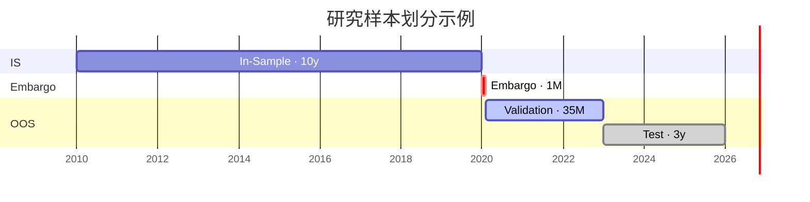

# Research Spec

**版本**：v0.2

**日期**：2026-10-15

**描述**：本文档作为我们量化因子策略研究流程的通用说明书，它按模块说明每个环节研究的规则与方法。表述不绑定具体市场，适用于股票与 FICC（固定收益、外汇、大宗商品）。

M 代表研究模块（module）。

> 写作约定：
> - **表格**：属性统一、每格一个短语、用于查找和对照的信息，如资产类别与数据、样本分区及用途。比如 M1.3.1 的 类型 形态 数据归类，但是像形态特有处理的信息我觉得可以尝试不在表格里呈现

> - **分点**：带条件、步骤或原因的规则与方法

> - **编号列表**：有先后顺序的步骤，如模型训练

> - **段落**：只讲一件事、前后逻辑连贯的定义或说明，如各节开头的定义

> 标点：列表项末尾不加句号，段落末尾加句号。

---
## M0. 研究框架

<table>
   <thead>
      <tr>
         <th nowrap>模块</th>
         <th nowrap>名称</th>
         <th nowrap>小节</th>
      </tr>
   </thead>
   <tbody>
      <tr>
         <td nowrap><a href="#m1-数据etl">M1</a></td>
         <td nowrap><a href="#m1-数据etl">数据ETL</a></td>
         <td nowrap><a href="#m11-原始数据">原始数据</a> · <a href="#m12-数据源登记">数据源登记</a> · <a href="#m13-数据集构建">数据集构建</a>（<a href="#m131-原始数据形态归类">原始数据形态归类</a> · <a href="#m132-数据清洗">数据清洗</a> · <a href="#m133-数据对齐">数据对齐</a> · <a href="#m134-研究样本划分is--oos">研究样本划分（IS + OOS）</a> · <a href="#m135-数据存储">数据存储</a>）</td>
      </tr>
      <tr>
         <td nowrap><a href="#m2-因子公式构建与入库">M2</a></td>
         <td nowrap><a href="#m2-因子公式构建与入库">因子公式构建与入库</a></td>
         <td nowrap><a href="#m21-因子库分类">因子库分类</a> · <a href="#m22-因子公式构建">因子公式构建</a> · <a href="#m23-因子入库规范">因子入库规范</a>（<a href="#m231-因子库位置">因子库位置</a> · <a href="#m232-因子主题代码">因子主题代码</a> · <a href="#m233-因子卡片必填信息">因子卡片必填信息</a>）</td>
      </tr>
      <tr>
         <td nowrap><a href="#m3-因子研究与因子评价">M3</a></td>
         <td nowrap><a href="#m3-因子研究与因子评价">因子研究与因子评价</a></td>
         <td nowrap><a href="#c3-截面">截面</a>（<a href="#c31-基础频率">基础频率</a> · <a href="#c32-未来收益率">未来收益率</a> · <a href="#c33-因子值">因子值</a> · <a href="#c34-因子评价指标">因子评价指标</a> · <a href="#c35-样本内划分">样本内划分</a> · <a href="#c36-指标范围">指标范围</a>） · <a href="#t3-时序">时序</a></td>
      </tr>
      <tr>
         <td nowrap><a href="#m4-因子组合">M4</a></td>
         <td nowrap><a href="#m4-因子组合">因子组合</a></td>
         <td nowrap><a href="#m41-因子综合评分">因子综合评分</a> · <a href="#m42-因子选择">因子选择</a> · <a href="#m43-因子值标准化">因子值标准化</a> · <a href="#m44-未来收益率调整">未来收益率调整</a> · <a href="#m45-模型选择">模型选择</a> · <a href="#m46-数据处理">数据处理</a> · <a href="#m47-模型训练">模型训练</a> · <a href="#m48-模型检验">模型检验</a></td>
      </tr>
      <tr>
         <td nowrap><a href="#m5-策略与仓位">M5</a></td>
         <td nowrap><a href="#m5-策略与仓位">策略与仓位</a></td>
         <td nowrap><a href="#m51-目标持仓构建">目标持仓构建</a> · <a href="#m52-组合中性">组合中性</a></td>
      </tr>
      <tr>
         <td nowrap><a href="#m6-风险与成本">M6</a></td>
         <td nowrap><a href="#m6-风险与成本">风险与成本</a></td>
         <td nowrap><a href="#m61-交易成本">交易成本</a> · <a href="#m62-风险控制">风险控制</a></td>
      </tr>
      <tr>
         <td nowrap><a href="#m7-回测与执行">M7</a></td>
         <td nowrap><a href="#m7-回测与执行">回测与执行</a></td>
         <td nowrap><a href="#m71-执行假设">执行假设</a> · <a href="#m72-策略回测与评价">策略回测与评价</a></td>
      </tr>
      <tr>
         <td nowrap><a href="#m8-实盘模拟">M8</a></td>
         <td nowrap><a href="#m8-实盘模拟">实盘模拟</a></td>
         <td nowrap><a href="#m81-滚动训练">滚动训练</a></td>
      </tr>
      <tr>
         <td nowrap><a href="#m9-已知局限和待解决问题">M9</a></td>
         <td nowrap><a href="#m9-已知局限和待解决问题">已知局限和待解决问题</a></td>
         <td nowrap>—</td>
      </tr>
   </tbody>
</table>

---
## M1. 数据ETL
本节分为三部分：
M1.1 定义原始数据的范围；
M1.2 定义数据源录入格式；
M1.3 定义资产数据与信号数据的构建流程（归类、清洗、对齐、划分、存储）。

### M1.1 原始数据

<table>
   <thead>
      <tr>
         <th nowrap>一级资产类别</th>
         <th nowrap>二级业务类别</th>
         <th nowrap>资产交易数据(计算可交易收益)</th>
         <th nowrap>信号数据(用于构建/评价因子)</th>
      </tr>
   </thead>
   <tbody>
      <tr>
         <td nowrap rowspan="2">股票</td>
         <td nowrap>现货</td>
         <td nowrap>上市普通股</td>
         <td nowrap>基本面（财报、估值）、分析师预期、指数成分与权重、公司行为（分红、拆股、回购）、融券 / 做空余额、资金流、新闻情绪</td>
      </tr>
      <tr>
         <td nowrap>衍生品</td>
         <td nowrap>期货：股指期货；期权：个股期权、股指期权</td>
         <td nowrap>期货基差与期限结构、持仓量、CFTC COT 持仓报告、期权隐含波动率曲面、偏度、Put/Call 比、VIX</td>
      </tr>
      <tr>
         <td nowrap rowspan="2">固定收益</td>
         <td nowrap>现货</td>
         <td nowrap>债券：国债（含短期国库券）、公司债；回购：国债回购、标准化回购工具</td>
         <td nowrap>国债收益率曲线、信用利差、信用评级、发行与到期日历、回购 / 资金利率</td>
      </tr>
      <tr>
         <td nowrap>衍生品</td>
         <td nowrap>期货：国债期货、短期利率期货；互换：固定对浮动利率互换；信用衍生品：单一名称 CDS、CDS 指数</td>
         <td nowrap>期货基差、CTD 与隐含回购利率、持仓量、COT、互换利差、CDS 利差期限结构、利率期权隐含波动率</td>
      </tr>
      <tr>
         <td nowrap rowspan="2">外汇</td>
         <td nowrap>现货</td>
         <td nowrap>可交易货币对即期</td>
         <td nowrap>各国短期利率（利差）、购买力平价 / 实际有效汇率、经常账户、央行政策利率与议息日历</td>
      </tr>
      <tr>
         <td nowrap>衍生品</td>
         <td nowrap>远期：可交割外汇远期、NDF；掉期：近端与远端反向交易</td>
         <td nowrap>远期点数（隐含利差 / Carry）、交叉货币基差、外汇期权隐含波动率与风险逆转、COT 持仓</td>
      </tr>
      <tr>
         <td nowrap>大宗商品</td>
         <td nowrap>衍生品</td>
         <td nowrap>期货：能源、金属、农产品等期货合约</td>
         <td nowrap>期限结构（升贴水 / 展期收益）、库存、COT 持仓、供需报告（如 EIA、USDA WASDE）、现货价格与基差、天气</td>
      </tr>
      <tr>
         <td nowrap>跨资产</td>
         <td nowrap>—</td>
         <td nowrap>—</td>
         <td nowrap>宏观经济（GDP、CPI、PMI、就业）、经济 / 事件日历、行业 / 板块分类、风险因子数据（见 M3.4）、跨市场资金流与情绪</td>
      </tr>
   </tbody>
</table>

### M1.2 数据源登记

所有已登记的数据源信息都应当记录在[`data/README.md`](data/README.md)中, 每一个数据源应当以卡片形式保存并包含以下信息:

<table>
   <thead>
      <tr>
         <th nowrap>用途</th>
         <th nowrap>一级资产类别</th>
         <th nowrap>二级业务类别</th>
         <th nowrap>交易工具</th>
         <th nowrap>数据接口</th>
         <th nowrap>可下载字段</th>
         <th nowrap>数据频率</th>
         <th nowrap>可用时间</th>
      </tr>
   </thead>
   <tbody>
      <tr>
         <td nowrap>资产数据 / 信号数据</td>
         <td nowrap>股票 / 固定收益 / 外汇 / 大宗商品</td>
         <td nowrap>现货 / 衍生品</td>
         <td nowrap>见 M1.1，如股指期货、外汇远期</td>
         <td nowrap>API 名称或下载方式</td>
         <td nowrap>接口返回的字段列表</td>
         <td nowrap>日频及以上（当前版本不支持日内）</td>
         <td nowrap>数据发布时点与延迟（UTC），用于 M1.3.3 point-in-time 约束</td>
      </tr>
   </tbody>
</table>

### M1.3 数据集构建

从 M1.2 数据源下载M1.1原始数据后，按 归类 → 清洗 → 对齐 → 划分 → 存储 五步构建数据集（资产数据与信号数据）。当前版本只支持日频及以上数据，Tick、分钟级数据暂不纳入。

#### M1.3.1 原始数据形态归类

资产数据按 A–D、信号数据按 S1–S4 归类，清洗时按形态分派处理函数：

<table>
   <thead>
      <tr>
         <th nowrap>类型</th>
         <th nowrap>形态</th>
         <th nowrap>数据</th>
         <th nowrap>形态特有处理</th>
      </tr>
   </thead>
   <tbody>
      <tr>
         <td nowrap rowspan="6"><b>资产数据</b></td>
         <td nowrap rowspan="3"><b>A. 现货价格型</b></td>
         <td nowrap>股票现货</td>
         <td nowrap>拆股 / 分红复权；保留退市股（防幸存者偏差）</td>
      </tr>
      <tr>
         <td nowrap>债券现货</td>
         <td nowrap>净价 / 全价、应计利息</td>
      </tr>
      <tr>
         <td nowrap>外汇即期</td>
         <td nowrap>统一报价方向（如统一以 USD 计价）</td>
      </tr>
      <tr>
         <td nowrap><b>B. 到期合约型</b></td>
         <td nowrap>股指期货、国债期货、短期利率期货、商品期货、可交割外汇远期</td>
         <td nowrap>换月规则、连续合约拼接、到期日处理、涨跌停</td>
      </tr>
      <tr>
         <td nowrap><b>C. 利率 / 利差曲线型</b></td>
         <td nowrap>回购、利率互换、CDS、NDF、外汇掉期</td>
         <td nowrap>报价为利率 / 利差 / 点数而非价格；按期限组织；收益通过久期 / DV01 换算；CDS 指数每半年换系列</td>
      </tr>
      <tr>
         <td nowrap><b>D. 期权型</b></td>
         <td nowrap>个股期权、股指期权</td>
         <td nowrap>行权价 × 到期日二维结构；流动性稀疏；计算隐含波动率</td>
      </tr>
      <tr>
         <td nowrap rowspan="4"><b>信号数据</b></td>
         <td nowrap><b>S1. 资产级序列</b></td>
         <td nowrap>基本面、分析师预期、融券余额、资金流、持仓量、COT、基差、库存</td>
         <td nowrap>映射到 <code>asset_id</code>（处理代码变更、合约映射）；财报按披露日而非报告期标注</td>
      </tr>
      <tr>
         <td nowrap><b>S2. 宏观 / 市场级序列</b></td>
         <td nowrap>GDP、CPI、PMI、就业、政策利率、VIX、风险因子</td>
         <td nowrap>按发布日而非参考期标注；使用首发值而非修订值（有 vintage 数据时）</td>
      </tr>
      <tr>
         <td nowrap><b>S3. 曲线 / 曲面</b></td>
         <td nowrap>收益率曲线、CDS 利差期限结构、隐含波动率曲面、期货期限结构</td>
         <td nowrap>统一到标准期限节点 / moneyness 网格（插值方法待填写）</td>
      </tr>
      <tr>
         <td nowrap><b>S4. 分类 / 事件</b></td>
         <td nowrap>行业分类、指数成分、公司行为、经济 / 事件日历、新闻</td>
         <td nowrap>保留历史版本（按当时有效值，防幸存者偏差）；事件按发生时间戳记录</td>
      </tr>
   </tbody>
</table>

#### M1.3.2 数据清洗

资产数据与信号数据共用一条 pipeline，仅第 3 步按形态分派处理函数（新增形态只需新增一个处理函数）；第 4 步按问题标注适用范围：

<table>
   <thead>
      <tr>
         <th nowrap>步骤</th>
         <th nowrap>问题</th>
         <th nowrap>规则</th>
      </tr>
   </thead>
   <tbody>
      <tr>
         <td nowrap>1. 标准化</td>
         <td nowrap colspan="2">统一字段名、标识符、时间戳（UTC）、单位</td>
      </tr>
      <tr>
         <td nowrap>2. 诊断</td>
         <td nowrap colspan="2">资产数据：检查缺失、重复、异常跳变、零成交、价格超出涨跌停；信号数据：检查缺失、重复、异常值、发布延迟与修订；输出质量报告</td>
      </tr>
      <tr>
         <td nowrap>3. 形态处理</td>
         <td nowrap colspan="2">资产数据按 A–D、信号数据按 S1–S4 执行 M1.3.1 中对应形态的特有处理</td>
      </tr>
      <tr>
         <td nowrap rowspan="8">4. 通用处理</td>
         <td nowrap>重复 · 通用</td>
         <td nowrap>删除：同一 <code>date, asset_id</code> / <code>date, series_id</code> 只保留最后一条</td>
      </tr>
      <tr>
         <td nowrap>缺失 · 资产</td>
         <td nowrap>填补：价格前向填充最多 N 期（N 取决于具体问题，由具体数据分析确定），超过 N 期记为 NaN；填补期的 <code>ret</code> 记为 NaN，不可产生收益</td>
      </tr>
      <tr>
         <td nowrap>缺失 · 信号</td>
         <td nowrap>低频序列在两次发布之间沿用最新已发布值（不插值）；应发布而未发布时记为 NaN</td>
      </tr>
      <tr>
         <td nowrap>异常跳变 · 资产</td>
         <td nowrap>标记：先核对是否为复权 / 换月遗漏，可修正则回到第 3 步；无法解释则记为 NaN（跳变阈值待填写）</td>
      </tr>
      <tr>
         <td nowrap>异常值 · 信号</td>
         <td nowrap>标记：保留原值，是否缩尾留到 M4.3 因子标准化处理</td>
      </tr>
      <tr>
         <td nowrap>零成交 · 资产</td>
         <td nowrap>标记：保留价格，<code>tradable</code> 记为 false，不参与当日截面</td>
      </tr>
      <tr>
         <td nowrap>价格超出涨跌停 · 资产</td>
         <td nowrap>删除：视为数据错误，记为 NaN；恰好触及涨跌停则只标记 <code>tradable</code> 为 false</td>
      </tr>
      <tr>
         <td nowrap>数据修订 · 信号</td>
         <td nowrap>保留首发值；无 vintage 数据时在 <code>quality_flag</code> 中标记"可能含修订"</td>
      </tr>
   </tbody>
</table>

#### M1.3.3 数据对齐

<table>
   <thead>
      <tr>
         <th nowrap>步骤</th>
         <th nowrap>规则</th>
      </tr>
   </thead>
   <tbody>
      <tr>
         <td nowrap>1. 时区</td>
         <td nowrap>存储统一用 UTC；每个资产的日 bar 取其所在市场收盘价，按交易日标注日期；信号数据按发布时间戳记录</td>
      </tr>
      <tr>
         <td nowrap>2. 交易日历</td>
         <td nowrap>采用一个主日历（NYSE）；某市场休市当天，该资产 <code>ret</code> 记为 NaN 并标记不可交易，不可视为 0 收益</td>
      </tr>
      <tr>
         <td nowrap>3. 信号对齐</td>
         <td nowrap>信号数据按 as-of 方式对齐到主日历：每个交易日取 <code>available_at</code> 早于决策时点的最新值；S1 / S4 通过 <code>asset_id</code> 与资产面板连接，按当时有效版本映射</td>
      </tr>
      <tr>
         <td nowrap>4. 可用时间</td>
         <td nowrap>按 M1.2 的"可用时间"做 point-in-time 约束：t 日信号只能使用决策时点前已发布的数据（如亚洲收盘早于美国、基本面披露滞后）；无精确发布时间的信号按保守滞后处理（滞后长度待填写）</td>
      </tr>
   </tbody>
</table>

#### M1.3.4 研究样本划分（IS + OOS）

将清洗对齐后的资产数据与信号数据按同一套日期划分为以下分区（信号数据以 `available_at` 判断所属分区）：

<table>
   <thead>
      <tr>
         <th nowrap>分区</th>
         <th nowrap>用途</th>
      </tr>
   </thead>
   <tbody>
      <tr>
         <td nowrap><b>In-Sample (IS)</b></td>
         <td nowrap>评价和筛选因子，训练因子模型</td>
      </tr>
      <tr>
         <td nowrap><b>Embargo</b></td>
         <td nowrap>隔离带，丢弃</td>
      </tr>
      <tr>
         <td nowrap><b>OOS Validation</b></td>
         <td nowrap>选定因子模型超参数</td>
      </tr>
      <tr>
         <td nowrap><b>OOS Test</b></td>
         <td nowrap>无偏检验与回测</td>
      </tr>
   </tbody>
</table>

示例（仅示意，日期与长度非最终设定）：

#### M1.3.5 数据存储

<table>
   <thead>
      <tr>
         <th nowrap>项目</th>
         <th nowrap>规则</th>
      </tr>
   </thead>
   <tbody>
      <tr>
         <td nowrap>工作目录</td>
         <td nowrap><a href="data/"><code>data/</code></a></td>
      </tr>
      <tr>
         <td nowrap>最终存储</td>
         <td nowrap>共享 iCloud 云盘（需向 Liangxiao 申请权限）,后期移至AWS S3</td>
      </tr>
      <tr>
         <td nowrap>资产数据文件命名</td>
         <td nowrap><code>{形态}_{一级资产类别}_{二级业务类别}_{时区}_{交易工具}_{交易日历}_{清洗日期}</code>，如 <code>A_股票_股票_上市普通股_UTC_NYSE_20261017</code></td>
      </tr>
      <tr>
         <td nowrap>信号数据文件命名</td>
         <td nowrap><code>{形态}_{数据类型}_{序列名}_{时区}_{交易日历}_{清洗日期}</code>，如 <code>S2_宏观_US_CPI_UTC_NYSE_20261017</code></td>
      </tr>
   </tbody>
</table>

**资产数据**：每个文件为一张面板，每行对应一个 `date × asset_id`，包含以下列（形态特有字段如期限、行权价追加在末尾）：

<table>
   <thead>
      <tr>
         <th nowrap><code>date</code></th>
         <th nowrap><code>asset_id</code></th>
         <th nowrap><code>form</code></th>
         <th nowrap><code>asset_class</code></th>
         <th nowrap><code>category</code></th>
         <th nowrap><code>close</code></th>
         <th nowrap><code>volume</code></th>
         <th nowrap><code>ret</code></th>
         <th nowrap><code>tradable</code></th>
         <th nowrap><code>quality_flag</code></th>
         <th nowrap><code>available_at</code></th>
      </tr>
   </thead>
   <tbody>
      <tr>
         <td nowrap>交易日</td>
         <td nowrap>资产标识符</td>
         <td nowrap>形态（A–D）</td>
         <td nowrap>一级资产类别</td>
         <td nowrap>二级业务类别（现货 / 衍生品）</td>
         <td nowrap>收盘价 / 报价（C 类为利率或利差）</td>
         <td nowrap>成交量</td>
         <td nowrap>可交易日收益，供 M3 使用</td>
         <td nowrap>当日是否可交易</td>
         <td nowrap>清洗标记（M1.3.2 第 4 步）</td>
         <td nowrap>数据可用时间（UTC，见 M1.3.3）</td>
      </tr>
   </tbody>
</table>

**信号数据**：每行对应一个 `date × series_id`，包含以下列（S3 曲线 / 曲面追加期限、moneyness 等列）：

<table>
   <thead>
      <tr>
         <th nowrap><code>date</code></th>
         <th nowrap><code>series_id</code></th>
         <th nowrap><code>form</code></th>
         <th nowrap><code>data_type</code></th>
         <th nowrap><code>value</code></th>
         <th nowrap><code>frequency</code></th>
         <th nowrap><code>quality_flag</code></th>
         <th nowrap><code>available_at</code></th>
      </tr>
   </thead>
   <tbody>
      <tr>
         <td nowrap>观测日期（参考期）</td>
         <td nowrap>序列标识符（如 <code>US_CPI</code>；行业分类等随资产变化的数据取 <code>asset_id</code>）</td>
         <td nowrap>形态（S1–S4）</td>
         <td nowrap>数据类型（取值见 M2.1）</td>
         <td nowrap>数值</td>
         <td nowrap>原始发布频率</td>
         <td nowrap>清洗标记（M1.3.2 第 4 步）</td>
         <td nowrap>数据可用时间（UTC，见 M1.3.3）</td>
      </tr>
   </tbody>
</table>

---

## M2. 因子公式构建与入库
本节分为三部分：
M2.1 定义因子库的分类维度；
M2.2 定义因子公式的构建方法；
M2.3 定义因子入库的规范。

### M2.1 因子库分类
每条因子按下表的 10 个维度分类，分类结果作为入库信息的一部分（见 M2.3）。"分类标签"描述因子本身；"研究设定"受 M1 数据与 M3 评价方式约束，标"暂不支持"的取值当前版本不可用。

<table>
   <thead>
      <tr>
         <th nowrap>类型</th>
         <th nowrap>分类维度</th>
         <th nowrap>具体类别示例</th>
      </tr>
   </thead>
   <tbody>
      <tr>
         <td nowrap rowspan="7"><b>分类标签</b></td>
         <td nowrap>1. 因子主题</td>
         <td nowrap>动量、反转、价值、质量、Carry、流动性、波动率、期限结构、信用、宏观、情绪、供需</td>
      </tr>
      <tr>
         <td nowrap>2. 经济机制</td>
         <td nowrap>风险补偿、行为偏差、市场摩擦、基本面定价、宏观传导、统计规律</td>
      </tr>
      <tr>
         <td nowrap>3. 数据类型</td>
         <td nowrap>价格、成交量、订单簿、基本面、持仓、收益率曲线、期权、宏观、另类数据（所用数据须先在 M1.2 登记）</td>
      </tr>
      <tr>
         <td nowrap>4. 适用资产类别</td>
         <td nowrap>股票、固定收益、外汇、大宗商品（与 M1.1 一致）、跨资产</td>
      </tr>
      <tr>
         <td nowrap>5. 信号结构</td>
         <td nowrap>时间序列、横截面、面板、曲线 / 期限结构、跨资产相对价值</td>
      </tr>
      <tr>
         <td nowrap>6. 计算方式</td>
         <td nowrap>水平值、变化率、价差、比值、排名、Z-score、回归残差、模型输出</td>
      </tr>
      <tr>
         <td nowrap>7. 因子作用范围</td>
         <td nowrap>单资产、行业 / 板块（依赖 M1.2 行业分类数据）、跨品种、市场级、宏观级</td>
      </tr>
      <tr>
         <td nowrap rowspan="3"><b>研究设定</b></td>
         <td nowrap>8. 预测目标</td>
         <td nowrap>未来收益、超额收益；方向、波动率、利差变化、风险状态（暂不支持）</td>
      </tr>
      <tr>
         <td nowrap>9. 预测周期</td>
         <td nowrap>短期（1–5D）、中期（5–20D）、长期（1M+）；日内（暂不支持）</td>
      </tr>
      <tr>
         <td nowrap>10. 更新频率</td>
         <td nowrap>日频、周频、月频、事件驱动；Tick、分钟（暂不支持）</td>
      </tr>
   </tbody>
</table>

- **期限 / 合约属性**、**历史回看窗口**是因子参数而非分类，在 M2.3 必填信息中记录；合约连续方式默认采用 M1.3.1 规则，因子只记录与默认不同之处。
- **风险暴露**不在入库时分类，由 M3.4 因子风险画像计算得出。
- **时间序列型因子**的评价方式待在 M3 中补充（M3.4 当前指标均为横截面指标）。

### M2.2 因子公式构建

<table>
   <thead>
      <tr>
         <th nowrap>方法</th>
         <th nowrap>核心思路</th>
      </tr>
   </thead>
   <tbody>
      <tr>
         <td nowrap><b>1. 文献复现</b>（Literature-based）</td>
         <td nowrap>从公开学术研究或已有量化策略中获取因子公式，并进行复现、迁移或改进</td>
      </tr>
      <tr>
         <td nowrap><b>2. 经济假设</b>（Hypothesis-driven）</td>
         <td nowrap>观察市场现象，提出明确、可证伪的经济假设，再设计因子公式并实证检验</td>
      </tr>
      <tr>
         <td nowrap><b>3. 现代统计</b>（ML / DL）</td>
         <td nowrap>用机器学习 / 深度学习模型从数据中学习预测信号，信号不一定有显式公式</td>
      </tr>
      <tr>
         <td nowrap><b>4. 算法搜索</b>（Algorithmic Search）</td>
         <td nowrap>在预定义的数据字段、数学算子及搜索空间内，自动搜索潜在有效的因子表达式</td>
      </tr>
      <tr>
         <td nowrap><b>5. 因子变换与组合</b>（Transformation &amp; Combination）</td>
         <td nowrap>对已有因子做数学变换、标准化、中性化、交互或组合，构建新的候选因子</td>
      </tr>
      <tr>
         <td nowrap><b>6. 事件驱动</b>（Event / Rule-based）</td>
         <td nowrap>根据市场事件、制度变化、公告或交易规则，构建反映事件冲击及市场反应的信号</td>
      </tr>
   </tbody>
</table>

### M2.3 因子入库规范

#### M2.3.1 因子库位置

<table>
   <thead>
      <tr>
         <th nowrap>项目</th>
         <th nowrap>规则</th>
      </tr>
   </thead>
   <tbody>
      <tr>
         <td nowrap>因子卡片</td>
         <td nowrap><code>factor/cards/{factor_id}.yaml</code>：每条因子一张卡片，记录下方必填信息</td>
      </tr>
      <tr>
         <td nowrap>因子代码</td>
         <td nowrap><code>factor/code/{factor_id}.py</code>：输入 M1.3.5 的资产 / 信号数据，输出因子值</td>
      </tr>
      <tr>
         <td nowrap>因子总表</td>
         <td nowrap><code>factor/README.md</code>：由脚本根据全部卡片自动生成，不手动编辑</td>
      </tr>
   </tbody>
</table>

#### M2.3.2 因子主题代码

<table>
   <thead>
      <tr>
         <th nowrap><code>MOM</code></th>
         <th nowrap><code>REV</code></th>
         <th nowrap><code>VAL</code></th>
         <th nowrap><code>QUA</code></th>
         <th nowrap><code>CAR</code></th>
         <th nowrap><code>LIQ</code></th>
         <th nowrap><code>VOL</code></th>
         <th nowrap><code>TRM</code></th>
         <th nowrap><code>CRD</code></th>
         <th nowrap><code>MAC</code></th>
         <th nowrap><code>SEN</code></th>
         <th nowrap><code>SUP</code></th>
      </tr>
   </thead>
   <tbody>
      <tr>
         <td nowrap>动量</td>
         <td nowrap>反转</td>
         <td nowrap>价值</td>
         <td nowrap>质量</td>
         <td nowrap>Carry</td>
         <td nowrap>流动性</td>
         <td nowrap>波动率</td>
         <td nowrap>期限结构</td>
         <td nowrap>信用</td>
         <td nowrap>宏观</td>
         <td nowrap>情绪</td>
         <td nowrap>供需</td>
      </tr>
   </tbody>
</table>

#### M2.3.3 因子卡片必填信息

<table>
   <thead>
      <tr>
         <th nowrap><code>factor_id</code></th>
         <th nowrap><code>method</code></th>
         <th nowrap><code>tags</code></th>
         <th nowrap><code>settings</code></th>
         <th nowrap><code>formula</code></th>
         <th nowrap><code>hypothesis</code></th>
         <th nowrap><code>expected_sign</code></th>
         <th nowrap><code>inputs</code></th>
         <th nowrap><code>params</code></th>
         <th nowrap><code>available_at</code></th>
         <th nowrap><code>reference</code></th>
         <th nowrap><code>status</code></th>
         <th nowrap><code>owner</code></th>
         <th nowrap><code>updated</code></th>
      </tr>
   </thead>
   <tbody>
      <tr>
         <td nowrap>{主题代码}_{三位序号}，如 <code>MOM_001</code></td>
         <td nowrap>构建方法（M2.2 第 1–6 种）</td>
         <td nowrap>分类标签（M2.1 第 1–7 维）</td>
         <td nowrap>研究设定（M2.1 第 8–10 维）</td>
         <td nowrap>公式（数学表达式或模型说明）</td>
         <td nowrap>经济逻辑 / 假设</td>
         <td nowrap>预期方向（+ / −）</td>
         <td nowrap>所用数据（M1.2 数据源与 M1.3.5 列名）</td>
         <td nowrap>参数：回看窗口、期限 / 合约属性（与 M1.3.1 默认不同时）等</td>
         <td nowrap>因子值在 t 日的可用时点（UTC）</td>
         <td nowrap>来源文献或研报</td>
         <td nowrap>状态（见下方状态流转）</td>
         <td nowrap>负责人</td>
         <td nowrap>最后修改日期</td>
      </tr>
   </tbody>
</table>

不同构建方法（M2.2）需额外记录：

<table>
   <thead>
      <tr>
         <th nowrap>构建方法</th>
         <th nowrap>额外必填 / 要求</th>
      </tr>
   </thead>
   <tbody>
      <tr>
         <td nowrap>1. 文献复现</td>
         <td nowrap>原文出处；与原文在样本、市场、定义上的差异</td>
      </tr>
      <tr>
         <td nowrap>2. 经济假设</td>
         <td nowrap>假设与预期方向须在首次回测前写入卡片（先假设、后检验）</td>
      </tr>
      <tr>
         <td nowrap>3. 现代统计</td>
         <td nowrap>模型类型、特征列表、超参数、训练窗口；只能用 IS 训练；保存模型文件</td>
      </tr>
      <tr>
         <td nowrap>4. 算法搜索</td>
         <td nowrap>数据字段与算子集合、搜索空间大小、试验总次数（供 M3 多重检验校正）</td>
      </tr>
      <tr>
         <td nowrap>5. 因子变换与组合</td>
         <td nowrap>父因子 <code>factor_id@version</code> 与变换方式</td>
      </tr>
      <tr>
         <td nowrap>6. 事件驱动</td>
         <td nowrap>事件定义、事件窗口、事件时间戳来源</td>
      </tr>
   </tbody>
</table>

---

## M3. 因子研究与因子评价
本节按因子的用途分为两部分：
C3 定义截面用途的研究与评价方法，即用因子预测同一时刻各资产之间的相对收益；
T3 定义时序用途的研究与评价方法，即用因子预测单个资产自身的绝对收益。

两部分各自独立成文，内容重叠时在各自小节中分别写明，不相互引用。

C 表示截面（cross-section），T 表示时序（time-series）。

### C3. 截面
横截面指固定一根 bar，资产集内所有 symbol 上的取值。截面方法检验的是：在每根 bar 上，与其他 symbol 相比因子值越高的 symbol，未来收益率是否也越高，即寻找排序的规律。

本节分为六部分：
C3.1 定义基础频率；
C3.2 定义未来收益率；
C3.3 定义因子值及其预处理；
C3.4 定义用什么指标检验因子特性；
C3.5 定义样本内划分方法；
C3.6 定义各检验指标的计算范围。

#### C3.1 基础频率
将原始 bar 合成为基础 bar，基础 bar 的频率 `Δ` 即交易频率，各字段按其自身性质分别合成。基础 bar 按各资产自身的交易日历划分，休市时段不算缺失。交易时段内任一根原始 bar 缺失时，该基础 bar 标记为缺失，不参与后续计算。因子值与未来收益率均以基础 bar 为单位计算。

#### C3.2 未来收益率
我们将资产从第 t 根 bar 收盘到第 t+1 根 bar 收盘的收益率作为未来收益率，作为第 t 根 bar 收盘时可得信号的预测对象。持有期即一根 bar，每根 bar 调仓一次。这一口径衡量的是因子预测能力的理论上限，假设信号一经可得即可按收盘价成交，策略交易时再考虑具体如何建仓。未来收益率按以下步骤计算：
1. **原始收益率**：
   - **收益率口径**：收益率须与实际持有该工具得到的收益一致：
     - 股票：含分红的总收益
     - 期货：不含连续合约换月时的价格跳空
     - 外汇远期 / 掉期：含两种货币之间的利差
     - 债券：含票息与应计利息的总收益

   - **跨市场对齐**：若同一横截面内资产的收盘时刻不同，为横截面约定一个统一时点，所有资产以该时点前最新的可得价格作为收盘价，信号与收益率都按这个时点计算

   - **退市收益**：symbol 在第 t+1 根 bar 退市时，其未来收益率为第 t 根 bar 收盘价到退市后可实现价值的收益率，可实现价值如并购对价、清算分配；缺失时按退市原因取经验值补齐

2. **波动率调整**：将未来收益率乘以 `σ_tgt` / σ，得到每个 symbol 按目标波动率配仓时的收益率，衡量每单位风险的收益；其中 `σ_tgt` 为设定的目标波动率；σ 为该 symbol 的历史波动率，只用第 t 根 bar 及之前长度为 `L_σ` 的窗口估计；两者换算到同一时间尺度（如同为年化）

#### C3.3 因子值
因子值是因子公式在某个 (timestamp, symbol) 上的输出，公式的回看窗口按基础频率定义，并注明对应的时间长度。因子公式所需历史不足时，将该 (timestamp, symbol) 的因子值标为 NaN。在进入评价之前，按因子特性选择以下预处理步骤：
1. **异常值修正**：
   - **均值标准差修正法**：每根 bar 的横截面上，将偏离均值超过 3 倍标准差的值拉回到均值 ± 3 倍标准差；标准差反映因子值的离散程度，但均值和标准差本身容易受极端值影响

   - **中位数去极值法**：每根 bar 的横截面上，将偏离中位数超过 3 倍 MAD 的值拉回到中位数 ± 3 × MAD；MAD 为各值与中位数之差的绝对值的中位数，乘以 1.4826 后在正态分布下与标准差可比；中位数和 MAD 不受极端值影响，比均值标准差修正法更稳健

   - **固定比率修正法**：每根 bar 的横截面上，将高于 1 − `θ_win` 分位数或低于 `θ_win` 分位数的值，分别拉回到这两个分位数

2. **空缺值处理**：
   - **覆盖率**：每根 bar 的横截面上，因子值缺失的 symbol 默认不填补，按原始因子值统计有效 symbol 数，少于最小横截面数 `N_min` 时，整根 bar 对该因子不计入后续评价指标计算；通过筛选的样本 bar 数记为 `T`

   - **历史数据插值**：对每个 symbol，若其在某根 bar 上的因子值缺失、但之前的 bar 有效，用最近一次的有效值向前填充，最多填充 `N_fill` 根 bar，超过仍缺失则保持 NaN

3. **分布调整**：
   - **对数调整**：取值跨越多个数量级、明显右偏的因子（如市值、成交额、成交量），直接对因子值取自然对数 ln(x)，压缩右侧的极端值

4. **因子中性化**：每根 bar 的横截面上，以因子值为因变量、需要剔除的暴露为自变量做多元线性回归，取残差作为中性化后的因子值；需要剔除的暴露按资产类别选择，如股票的行业二元变量、对数市值与市场 beta 等

#### C3.4 因子评价指标
因子值预处理完成后，用以下指标评价因子，具体计算方式按因子值的特性调整：

**主指标**：
- **Rank IC**：
   - **计算方式**：每根 bar 的横截面上，计算因子值与下一根 bar 未来收益率的 Spearman 相关性；t 值、p 值、95% 置信区间用 Newey-West HAC（1994）调整后的标准误计算，滞后阶数按 Newey-West 的方法自动选择
   - **目的**：指标衡量因子值的横截面排序对未来收益率排序的预测能力；因子值前后相关可能导致 Rank IC 序列自相关，因此用 Newey-West 调整 t-test 的标准误；其中滞后阶数由每个因子的 Rank IC 序列自身的自相关结构估计得出，自相关越强，滞后阶数越大
   - **汇总**：Rank IC 均值、信息比率（Rank IC 均值 ÷ Rank IC 标准差，以下简称 IC IR）、滞后阶数、t 值、p 值、95% 置信区间、IC 胜率（Rank IC 正值占比）、偏度、Pearson 峰度

- **分层价差**：
   - **计算方式**：每根 bar 的横截面上，按因子值分为 `K` 组，bucket 1 = 最低，bucket `K` = 最高，计算每组下一根 bar 的未来收益率均值；计算前先在该 bar 的横截面上对收益率做比例为 `θ_win` 的双侧缩尾；多空价差是一半资金做多 top 组、一半做空 bottom 组的组合收益率，即 (top − bottom) / 2；t 值用 Newey-West 调整标准误计算，同 Rank IC
   - **目的**：衡量按因子分组做多空能获得多大的收益差；缩尾是为了防止极端值影响样本平均；因子值前后相关可能导致多空价差序列自相关，因此用 Newey-West 调整标准误
   - **汇总**：top-bottom 多空价差均值、滞后阶数、t 值

**方向判断**：
- **反向检验**：
   - **计算方式**：在 IS 全样本上算出 Rank IC 与分层价差的平均值，若两者同时为负，判为反向
   - **目的**：我们默认因子值与未来收益率正相关，但有些因子可能是负相关的，需要单独识别
   - **汇总**：输出该因子对应编号，不进入后续指标计算，进行独立分析

- **U 形检验**：
   - **计算方式**：在 IS 全样本上，算出各组未来收益率的均值（`K` 小于 3 时没有中间组，跳过该检验）；若 bucket 1 与 bucket `K` 的均值都高于中间各组均值的平均，判为 U 形；都低于，判为倒 U 形
   - **目的**：我们默认因子值与未来收益率是单调关系，但有些因子可能在两端极端值上同向偏离，需要单独识别
   - **汇总**：输出该因子对应编号，不进入后续指标计算，进行独立分析

**副指标**：
- **IC 衰减**：
   - **计算方式**：在第 t 根 bar 的横截面上，计算因子值与 r(k) 的 Rank IC，记为 IC(k)，IC(0) 即主指标里的 Rank IC，r(k) 为第 t+k 根 bar 收盘到第 t+k+1 根 bar 收盘的增量收益率，k = 0, 1, …, `H`；再按 IC(k) = IC(0)×e^(−λk) 对各 k 的 Rank IC 均值做非线性最小二乘拟合，拟合 λ，半衰期为 ln(2)/λ 根 bar，λ ≤ 0 时记半衰期为无穷大
   - **目的**：衡量因子的预测力能撑多久
   - **汇总**：各 k 的 Rank IC 均值、λ、半衰期

- **分层条件在险价值（CVaR）**：
   - **计算方式**：每根 bar 的横截面上计算未缩尾的多空价差，取在全部 bar 中最差的 `θ_CVaR` 比例求平均
   - **目的**：衡量最坏情况下平均亏多少，补充分层价差因缩尾而忽略的极端值
   - **汇总**：CVaR

- **分层换手率**：
   - **计算方式**：每根 bar 的横截面上，统计 top 和 bottom bucket 里本根 bar 新进入、而上一根 bar 不在该 bucket 里的 symbol 数，占本根 bar 该 bucket symbol 数的比例
   - **目的**：衡量按因子调仓的频繁程度，作为交易成本的代理；换手既包含因子排名变化导致的部分，也包含 symbol 掉出资产集或数据缺失导致的部分，两者不做区分
   - **汇总**：top 和 bottom 各自的换手率均值，两者再取平均作为该因子的分层换手率

（以下指标共用同一条多空组合收益序列：第 t 根 bar 收盘时在该 bar 的横截面上按因子值分层，top 组和 bottom 组各占一半资金，按第 t 根 bar 收盘价建仓、第 t+1 根 bar 收盘价平仓，这笔未缩尾的收益记在第 t+1 根 bar 上。将这条序列复利累计，得到截至每根 bar 的累计盈亏。）

- **分层净值**：
   - **计算方式**：把得到的多空价差序列复利成累计净值
   - **目的**：展示多空组合随时间的累计表现
   - **汇总**：top-bottom 净值序列

- **分层夏普率**：
   - **计算方式**：对得到的多空价差序列计算均值与标准差之比，再乘以 √(每年 bar 数) 年化，每年 bar 数按主日历计算
   - **目的**：衡量多空组合承担单位风险获得的收益
   - **汇总**：top-bottom 夏普率

- **分层最大回撤**：
   - **计算方式**：把得到的多空价差序列复利成净值曲线，对这条净值曲线计算最大回撤
   - **目的**：衡量多空组合历史上从高点到低点的最大亏损
   - **汇总**：top-bottom 最大回撤

- **因子风险画像**：
   - **计算方式**：把多空价差序列按风险因子数据的频率复利聚合后，对该资产类别的共同风险因子做多元时间序列回归；风险因子集合按资产类别指定，例如：
     - 股票：Fama & French (2015) 五因子加动量因子；中国 A 股可用 Liu, Stambaugh & Yuan (2019) 的中国因子模型
     - FICC：各资产类别的市场因子，加上 Asness, Moskowitz & Pedersen (2013) 的价值、动量因子，以及 Koijen et al. (2018) 的 carry 因子
   - **目的**：衡量因子的收益有多少来自已知风险因子的暴露，alpha 是扣除这些暴露后因子独有的部分；公开的风险因子数据可能覆盖不到整个 IS，回归只在两者重叠的区间上做；如需覆盖整个 IS，可按原文方法用本项目的数据自行构建
   - **汇总**：各风险因子的 β、Newey-West 标准误及 t 值、alpha 及其 t 值、调整后的 R²

#### C3.5 样本内划分
我们把数据切分成子区间，目的是检验因子表现随历史时间的变化。以下为不同划分方式：
- **按期切分**：把 IS 按日历分成互不重叠的若干长度为 `L_seg` 的段，段数记为 `P`，在每段上分别计算检验指标

#### C3.6 指标范围
我们按各指标的用途，划分其计算范围如下：
- **全样本计算**：Rank IC、IC 衰减、分层价差、分层 CVaR、分层换手率、分层净值、分层夏普率、分层最大回撤、因子风险画像

- **按期计算**：Rank IC 均值、分层多空价差均值

### T3. 时序
时间序列指固定一个 symbol，时间窗口内所有 bar 上的取值。时序方法检验的是：在每个 symbol 上，与自身历史相比因子值越高的 bar，未来收益率是否也越高，即寻找涨跌的规律。

---

## M4. 因子组合
本节分为八部分：
M4.1 定义因子综合评分方法；
M4.2 定义因子选择规则；
M4.3 定义因子值的标准化方法；
M4.4 定义未来收益率如何调整；
M4.5 定义合成因子信号的模型；
M4.6 定义训练前的数据处理方式；
M4.7 定义模型的初始训练与超参数选择；
M4.8 定义组合信号本身的评价方法。

### M4.1 因子综合评分
我们先对候选因子做初步筛选，再将通过筛选的因子的各项属性汇总为一个综合评分，用于排序，步骤如下：
1. **初筛**：
   - **显著性**：
      - **计算方式**：在 IS 全样本上，以下一根 bar 未来收益率判断，若 IC IR、Rank IC t 值、分层价差 t 值、因子风险画像 alpha t 值四者中有一项低于对应门槛 `IR_min`、`t_IC`、`t_spread`、`t_alpha`，或有效样本量 `T` 低于 `T_min`，直接剔除，不进入后续步骤。门槛依据情况而定，候选因子越多，门槛应相应提高
      - **目的**：剔除统计上不显著或效应过弱的因子，只让通过筛选的因子参与评分。判断只用全样本，不用按期数据，防止多次独立假设检验带来的假阳率升高

2. **属性计算**：
   - **稳定预测性**：
      - **计算方式**：在 IS 按期切分内，各段每个因子单独算下一根 bar 未来收益率的 Rank IC 均值，得到 `P` 个值，计算 S = 平均数 ÷（标准差 ÷ √P）
      - **目的**：同时衡量这个因子在各历史时段的效应大小与方向一致性，各段效应越大、越一致，S 值越高

   - **尾部风险**：
      - **计算方式**：在 IS 全样本中，用分层 CVaR 衡量，CVaR 越大越好
      - **目的**：衡量这个因子在极端行情下的下行风险有多大

   - **半衰期**：
      - **计算方式**：在 IS 全样本中，取 IC 衰减得到的半衰期，转成全部候选因子间的百分位排名；半衰期为无穷大的因子排名并列最优
      - **目的**：衡量这个因子的预测力能撑多久，半衰期越长，越不容易因为实际调仓被延迟而失效

   - **偏离度**：
      - **计算方式**：在 IS 全样本中，用 Rank IC 序列的偏度和峰度算一个惩罚值 D = max(−偏度, 0) × 峰度，即偏度为负时惩罚值等于偏度的绝对值乘以峰度，偏度为零或为正时惩罚值为 0，转成全部候选因子间的反向百分位排名
      - **目的**：衡量这个因子的预测关系会不会偶尔剧烈反转，只有负偏才说明存在反向失灵的风险

   - **可交易性**：
      - **计算方式**：在 IS 全样本中，把分层价差转成全部候选因子间的百分位排名，分层换手率转成全部候选因子间的反向百分位排名，两者取几何平均
      - **目的**：衡量实际交易这个因子的净摩擦成本有多大，价差大、换手率低的因子排名靠前

   - **风险暴露**：
      - **计算方式**：在 IS 内风险因子数据可得的区间上，将因子风险画像回归的 R²，转成全部候选因子间的反向百分位排名
      - **目的**：衡量这个因子的收益有多少是自己独有的，而不是已知风险因子暴露的另一种包装

3. **属性合成**：稳定预测性与尾部风险各自做 z-score 标准化；半衰期、偏离度、可交易性、风险暴露这四个属性已有的百分位排名，按排名 ÷（候选因子数 + 1）转成 (0, 1) 区间内的百分位，再各自用标准正态分布反函数（probit function）映射成同一尺度
   - **质量分**：稳定预测性、半衰期、偏离度算术平均
   - **交易分**：可交易性
   - **风险分**：尾部风险和风险暴露算术平均

4. **综合评分**：质量、交易、风险三项分别按权重 `ω_Q`、`ω_E`、`ω_R`（三者之和为 1）加权求和，得到单因子综合评分，按综合评分降序排列，作为后续因子选择的排序依据

### M4.2 因子选择
我们根据以下规则选择因子进入后续的组合，入选的因子视为在 IS 样本中表现出色：
- **因子排名**：取因子综合得分排名前 `θ_top` 的候选因子进入后续组合

- **因子互补性**：按综合得分从高到低遍历入选因子，保留当前因子，剔除其余与它相关性过高的因子，在剩下的因子里重复这一过程，直到遍历完。相关性用两个因子值在每根 bar 横截面上的 Spearman 相关系数 ρ，再对 IS 全部 bar 取平均来衡量，按 |ρ| 与阈值 `ρ_max` 比较

- **因子交易表现**：看入选因子各自的分层收益率图（均值调整）、分层净值曲线、夏普率、最大回撤，作为简易版审查，了解实际交易这些因子可能遇到的问题，人为进行最后一步筛选

### M4.3 因子值标准化
原始因子值量纲因公式而异，为了方便后续建模，我们在每根 bar 对该因子在横截面上的值做标准化，标准化后的数据面板作为之后模型拟合的输入，候选的标准化方法有以下几种：
- **Gauss-rank**：对有效样本按因子值做横截面排名，将排名转换成 (0, 1) 区间上的均匀分布，再用标准正态分布的反函数映射成正态分布的标准化值

- **z-score**：对有效样本的因子值先做比例为 `θ_win` 的横截面双侧缩尾，再算 z-score

### M4.4 未来收益率调整
模型的预测目标（标签）可在未来收益率的基础上，在每根 bar 上做进一步调整，候选的方法有以下几种：
- **均值调整**：将未来收益率减去当期横截面全部有效 symbol 的等权平均值，预测资产相对于横截面平均的收益率

- **波动率调整**：将未来收益率除以各 symbol 的历史波动率（只用第 t 根 bar 及之前长度为 `L_σ` 的窗口估计）后再做均值调整，预测资产经风险调整后的相对收益率，避免高波动资

- **Gauss-rank**：对未来收益率做横截面 Gauss-rank 变换，预测资产在当期横截面的收益率排名

- **z-score**：对未来收益率先做比例为 `θ_win` 的横截面双侧缩尾，再算 z-score，预测资产的收益率在当期横截面高出平均几个标准差

### M4.5 模型选择
我们按想要的输入和输出形式选择对应模型，合成组合信号。样本形式分为以下几种：
- **独立样本**：每个 (timestamp, symbol) 为独立观测，自变量 X_i 是该行入选因子的标准化值向量，因变量 y_i 是该行的预测目标。考虑以下模型：
   - **等权加法**：
      - 入选因子的标准化值直接等权平均，不需要训练

   - **Ridge Regression**：
      - 入选因子标准化值的线性加权，加 L2 惩罚压缩系数，系数可直接解释为各因子的权重
      - 超参数：正则化强度 α

   - **XGBoost**：
      - 梯度提升树，可以捕捉因子之间的非线性关系和交互作用
      - 超参数：树的最大深度、学习率、行/列采样比例、剪枝阈值

- **合并样本**：每个 timestamp 下，合并所有横截面的 symbol 为一个观测，自变量 X_i 是该 timestamp 下全部有效 symbol 的标准化值矩阵，因变量 y_i 是这些 symbol 各自的预测目标组成的向量。考虑以下模型：
   - **Transformer**：
      - 用自注意力在同一 timestamp 的全部 symbol 之间建模，不需要位置编码，symbol 之间没有顺序关系
      - 超参数：注意力头数、encoder 层数、隐藏维度、前馈层维度、dropout 比例、weight decay

### M4.6 数据处理
训练前先确认入选因子的完整性，因为因子选择后的面板不一定对齐，缺失的标准化因子值按模型各自的方式处理，不统一填补：
- **等权加法**：缺失的因子不参与平均，由该行剩余的有效因子重新等权平分

- **Ridge Regression**：缺失的标准化因子值填 0，即该因子在当期横截面上的中间值

- **XGBoost**：缺失值交给树的分裂规则原生处理

- **Transformer**：缺失的标准化因子值填 0，并附加缺失指示特征。各 timestamp 的 symbol 数不同，组批时补齐的 symbol 位置用掩码屏蔽，不参与注意力计算

### M4.7 模型训练
模型输入为标准化后的因子值，预测标签为调整后的未来收益率，训练包含以下步骤：
1. **训练目标**：在 IS 上训练模型，最小化模型预测值与预测标签之间的加权平方误差，加上模型自身的正则项。权重按 e^(−`κ`d) 做指数衰减，d 为观测距 IS 末尾的 bar 数，`κ` 为衰减速度，越大越偏重近期观测

2. **训练轮数**：仅适用于需要迭代训练的模型，有解析解的模型跳过这一步。用 early stopping，训练时每迭代一轮，在 OOS Validation 上算一次平方误差，连续 `N_pat` 轮不再下降就停止，取平方误差最小的那一轮

3. **选择超参数**：训练多个候选超参数组合，各自按第 2 步确定训练轮数后，比较它们在 OOS Validation 上的平方误差来选定。候选组合的搜索方式可选 grid search 或贝叶斯优化

### M4.8 模型检验
组合信号的评价在 OOS Test 上只做一次，计算 Rank IC、分层价差、分层净值、分层夏普率、分层最大回撤作为组合信号的评价结果，并画出分层收益率图和分层净值曲线。**同时报告等权加法的同一组指标和图作为基准**。

---

## M5. 策略与仓位
本节分为两部分：
M5.1 把信号转成每个 symbol 的目标持仓；
M5.2 检查组合市场中性。

### M5.1 目标持仓构建
根据模型输出的信号进行资产分配，每根 bar 都用当时的信号重新计算目标权重并整体调仓，可选以下几种方式：
1. **按排名分层**：每根 bar 横截面上按信号值排名，排名前 q 的 symbol 做多、后 q 的做空，等权分配资金（同分层测试结果相同）。

2. **按信号大小**：资金权重由信号大小决定：`weight = signal / Σ|signal|`，符号决定多空方向，大小跟信号强度成正比。为避免单个 symbol 信号异常导致仓位过度集中，对 `|weight|` 设一个上限，超出上限的部分直接截断；配平和缩放之后的上限检查见 M5.2。

3. **按风险调整**：在权重基础上，再除以各 symbol 的历史波动率（只用第 t 根 bar 及之前的数据估计），使每个 symbol 贡献的风险大致相当。同一横截面里资产波动率差别很大时（如国债期货与原油期货），应采用这种方式，否则组合风险会集中在高波动的品种上。

### M5.2 组合中性
不管用哪种方式构建权重，组合都要对 strategy 文档指定的暴露保持中性，这样策略的收益才能归因于因子的横截面排序能力，不混入未经研究验证的方向暴露。可选的中性目标：
- **资金中性**（默认）：多头、空头两侧占用的资金相等，净敞口为零。

- **beta 中性**：组合对市场的 beta 为零，各 symbol 的 beta 只用第 t 根 bar 及之前的数据估计。各资产 beta 差别大时，资金中性的组合仍可能带有明显的市场暴露，需要用 beta 中性。

- **行业 / 板块中性**：每个行业或板块内部的多空资金相等。

按两步校正：
1. **投影**：在当期持有的 symbol 上，把需要中性的暴露排成矩阵 B，每列对应一种暴露（资金中性为全 1 列，beta 中性为各 symbol 的 beta，行业中性为行业哑变量），令 `w ← w − B(BᵀB)⁻¹Bᵀw`。只做资金中性时，这一步就是减去当期权重的均值。

2. **缩放**：把权重整体按比例缩放，使总敞口回到目标水平。

若 M5.1 或 M6.2 对单个 symbol 设了权重上限，缩放后要重新检查：把超出上限的权重截断，再重复上面两步，直到满足上限或达到最大迭代次数。

若某资产类别不能直接做空（见 M1.1 做空约束），空头腿可改用指数期货等对冲工具，此时组合只能对该对冲工具代表的暴露保持中性，需在 strategy 文档中说明。

---

## M6. 风险与成本
本节分为两部分：
M6.1 定义交易成本的构成和计入方式；
M6.2 定义组合层面的风险控制。

### M6.1 交易成本
- **成本构成**：
  - 佣金与税费：按成交金额的固定比例计，包括佣金、交易所费用、印花税等
  - 买卖价差：按成交时的半个买卖价差计；没有盘口数据时，用 strategy 文档设定的经验值
  - 市场冲击：默认用平方根模型，冲击成本 = c × σ × √(成交额 ÷ 日均成交额)，σ 为日收益率波动率，系数 c 由 strategy 文档设定
  - 持仓成本：股票多头的融资利息、空头的借券费用，期货和外汇远期展期时额外支付的买卖价差

- **计入方式**：M3 的因子评价指标都是扣成本前的毛收益，M4.1 的可交易性只是成本的代理指标。成本在 M7 回测中扣除：每根 bar 按各 symbol 的实际调仓金额计算交易成本，按持仓金额计算持仓成本。

- **报告口径**：同时报告扣成本前、后的收益，以及盈亏平衡成本（每根 bar 毛收益均值 ÷ 每根 bar 换手率均值，换手率为 Σ|Δw|），即单位换手的成本达到多少时，策略的净收益归零。

### M6.2 风险控制
- **波动率目标**：用事前估计的组合波动率（只用第 t 根 bar 及之前的数据）整体缩放权重，使组合年化波动率接近 strategy 文档设定的目标值，同时设总杠杆上限。整体缩放不破坏 M5.2 的中性。

- **集中度上限**：单个 symbol、单个行业 / 板块、单个资产类别的权重上限，超限的处理见 M5.2。

- **流动性上限**：单个 symbol 的持仓金额不超过其日均成交额的一定比例，并据此估算策略容量。

---

## M7. 回测与执行
本节分为两部分：
M7.1 定义回测中的执行假设；
M7.2 定义回测流程与评价指标。

### M7.1 执行假设
- **成交价与时点**：与 M3.3 一致，第 t 根 bar 收盘后生成目标权重，按第 t+1 根 bar 的开盘价成交。

- **无法成交**：遇到停牌、涨跌停、无报价等无法按目标成交的情况，该 symbol 本期维持原持仓，其余 symbol 照常调仓；由此带来的中性偏离在回测结果中单独报告。

- **退出资产集与退市**：按 M1.1 的规则处理。

- **交易成本**：按 M6.1 扣除。

### M7.2 策略回测与评价
把 M5、M6 输出的目标权重面板和价格面板交给回测框架（如 vectorbt）模拟，得到这套目标持仓规则真实执行起来的表现。正式结果只在 OOS Test 上报告一次；IS 上的回测只用于诊断，不用于调参。
- **报告指标**：年化收益、年化波动率、夏普率、最大回撤、换手率、扣成本前后的收益与盈亏平衡成本、组合对市场的 beta 与风险因子暴露（方法同 M3.4 因子风险画像），多头、空头两侧各自的收益贡献（做空受限时，空头一侧的收益可能无法实现），以及按年份、资产类别拆分的表现。

- **基准**：用等权加法的组合信号按同样的规则回测，作为对照。

---

## M8. 实盘模拟

### M8.1 滚动训练
超参数选定后，模型按以下方式持续更新：
1. **固定超参数**：超参数使用 M4.7 选定的结果。

2. **重新拟合参数**：将 OOS Validation 的样本放入，扩张窗口，按 M4.7 第 1 步的时间衰减加权训练目标，重新拟合一次模型参数，作为这一轮实际使用的模型。

3. **重选超参数**：每三个月复查，留最近三个月的新数据当验证集，记为 NS，其余数据用来训练，记为 HS。候选超参数组合各自在 HS 上训练，比较它们在 NS 上的表现，重新选出这次要用的超参数，更新第 1 步固定的结果，直到下一次复查。

## M9. 已知局限和待解决问题
- **rank 排序**：单纯的 z-score 会被极端值放大分母、压缩其余差异，rank 只看名次、不受量级影响，但会丢失因子值的幅度信息，只保留排序。

- **零延迟假设的现实性**：零延迟假设是否现实，取决于所选 bar 频率与实际执行延迟的相对大小；spec 未固定频率，这个关系需要在选定具体频率后另行验证，不能一概而论。

- **样本量**

- **无多重检验校正**

- 金融数据间相关性做回归模型，有效样本少，无学习理论支撑，我们假设这个关系影响小