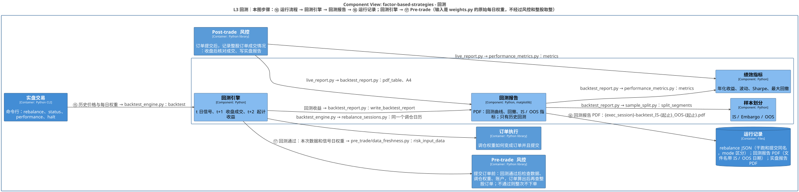

# fbs.backtesting：回测（C4 L3 + L4）

对策略 `weights.py` 算出的目标权重做日度回测，并按 config.yaml `split` 分 IS / Embargo / OOS 统计指标。它是每次 rebalance 的第一道门槛（[fbs.live](../live/README.md) 第 4 步）：回测算不出来或回测报告写不出来，这次运行就停下，不做风控、不下单。performance 命令也用它算实盘报告里的同期回测。

## L3 组件



| 文件 | 函数 | 做什么 |
| --- | --- | --- |
| [backtest_engine.py](backtest_engine.py) | `backtest(prices, weights, rule)` | 策略和等权基准的日收益，以及单边换手 |
| [performance_metrics.py](performance_metrics.py) | `metrics(r)`、`BARS_PER_YEAR` | 年化收益、年化波动、Sharpe、最大回撤 |
| [sample_split.py](sample_split.py) | `split_segments(bt, split)` | 每个交易日标为 IS、Embargo 或 OOS |
| [backtest_report.py](backtest_report.py) | `write_backtest_report(path, strategy, bt)` | 回测报告 PDF：回测曲线、回撤、按 IS / OOS 分段的指标；rebalance 第 4 步写进 records/。另有 `pdf_table`、`A4`，实盘报告也用 |

## L4 时间模型

和实盘 runner 完全一致：

```
收盘 t                         收盘 t+1                     收盘 t+2
  │ 用到 t 为止的数据             │ 收盘市价单成交                │ 开始计入收益
  │ 算出信号日 t 的权重            │ （= 实盘的执行日）             │
```

- 权重只在 config.yaml `rebalance` 规定的调仓日更新（用 [fbs.execution](../execution/README.md) 的 `execution_rebalance_sessions`），其余日子沿用上次的权重。
- 不计交易成本；调仓日之间不考虑权重随价格漂移。
- 从第一次有持仓的那天起统计。

样本划分：

| 段 | 范围 | 用途 |
| --- | --- | --- |
| IS | `backtest_start` 到 `split.is_end` | 选 params |
| Embargo | `is_end` 之后的 `embargo_sessions` 个交易日 | 不参与评价，隔开 IS 和 OOS |
| OOS | Embargo 之后到信号日 | 只做报告，不能拿来改 params |

## 计划中

- 回撤降仓和权重 adjust 实现后（architecture_new.md §5.15 第 4 步），回测要按日循环，并调用 [fbs.risk](../risk/README.md) 的同一套函数，否则回测和实盘对不上。
- 指标改用 [fbs.research.eval](../research/eval/README.md) 的共享实现。
