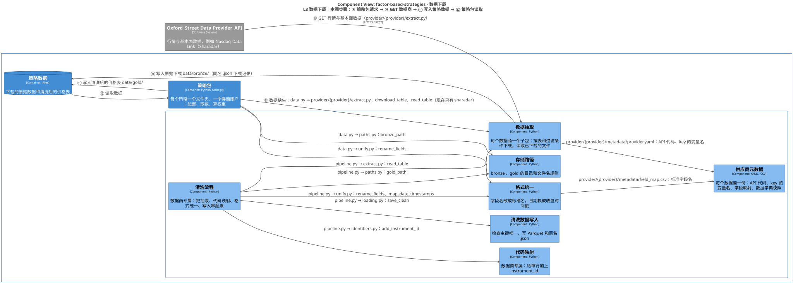

# fbs.etl：数据下载（C4 L3）

从数据商下载原始数据（bronze），统一格式后存成清洗数据（gold）。它是函数库，不单独运行，有两个调用方：

| 调用方 | 用到什么 | 写到哪 |
| --- | --- | --- |
| 策略的 `data.py` | `download_table`、`read_table`、`rename_fields`、`bronze_path` | 策略自己的 `strategy/{name}/data/`（gold 由 data.py 自己写，见 [strategy/README.md](../../../strategy/README.md)） |
| [provider/sharadar/pipeline.py](provider/sharadar/pipeline.py) | 本包全部步骤 | 仓库共享的 `data/bronze/`、`data/gold/` |

上级架构图（L1、L2）见 [根目录 README](../../../README.md#架构c4)；数据实体、文件布局和元数据见 [docs/Data_architecture/](../../../docs/Data_architecture/README.md)。

## L3 组件



## 文件

数据商专属的代码和元数据放在 `provider/{provider}/` 子文件夹（每个数据商一个子包），和数据商无关的放在根目录。现在只有 Sharadar 一家。

```
src/fbs/etl/
├── paths.py              bronze、gold 的目录和文件名规则
├── unify.py              字段名改成标准名，日期换成收盘时间戳
├── loading.py            写 gold Parquet 和同名 .json
└── provider/             每个数据商一个子包；接新数据商 = 在这里新建一个文件夹
    └── sharadar/
        ├── extract.py        从 Nasdaq Data Link 下载、读取 Sharadar 表
        ├── identifiers.py    按 permaticker 给每行加 instrument_id
        ├── pipeline.py       SEP 从 bronze 到 gold 的完整流程
        ├── metadata/         provider.yaml、field_map.csv、数据字典快照 DD_*.csv（进 git）
        └── Raw_Data_Sample/  本地小样本，测试用（不进 git）
```

## 函数

按 ETL 的先后顺序：

| 步骤 | 文件 | 函数 / 常量 | 做什么 |
| --- | --- | --- | --- |
| 路径 | [paths.py](paths.py) | `DATA_DIR`、`BRONZE_DIR`、`SILVER_DIR`、`GOLD_DIR` | 仓库 `data/` 和三层数据的根目录 |
| 路径 | [paths.py](paths.py) | `bronze_path` | 一次下载的文件路径：`bronze/{source}_{product}/{dataset}/{下载日期}_{过滤条件}.zip` |
| 路径 | [paths.py](paths.py) | `gold_path` | 清洗文件的路径：`gold/{asset_class}/{category}/{frequency}/{source}_{dataset}_{清洗日期}.parquet` |
| 抽取 | [provider/sharadar/extract.py](provider/sharadar/extract.py) | `download_table` | 按表、过滤条件和列下载一个 zip，旁边写一份同名 `.json` 下载记录；API 代码和 key 的环境变量名从 `metadata/provider.yaml` 读；文件已存在时默认不覆盖 |
| 抽取 | [provider/sharadar/extract.py](provider/sharadar/extract.py) | `read_table` | 读下载好的 zip，日期列转成日期，按 ticker、日期排序 |
| 代码映射 | [provider/sharadar/identifiers.py](provider/sharadar/identifiers.py) | `add_instrument_id` | 用 TICKERS 表把 ticker 换成 permaticker 作为 `instrument_id`；一对多或找不到就报错 |
| 格式统一 | [unify.py](unify.py) | `STANDARD_FIELDS` | 每个资产类别 gold 的标准列，股票（EQ）是 `instrument_id`、`timestamp`、OHLC、`close_raw`、`close_adj`、`volume` |
| 格式统一 | [unify.py](unify.py) | `rename_fields` | 按 `provider/{provider}/metadata/field_map.csv` 把数据商字段名改成标准名 |
| 格式统一 | [unify.py](unify.py) | `map_date_timestamps` | 日期换成交易所当天收盘的 UTC 时间戳；不是交易日就报错 |
| 写入 | [loading.py](loading.py) | `save_clean` | 检查 (`instrument_id`, `timestamp`) 唯一，排序后写 Parquet，旁边写一份同名 `.json` 清洗记录 |
| 流程 | [provider/sharadar/pipeline.py](provider/sharadar/pipeline.py) | `clean_sep` | SEP 日线：读取 → 代码映射 → 格式统一 → 写到 `gold/EQ/spot/daily/` |

所有写文件的函数都先写 `.part` 临时文件再改名，中途中断不会留下半个文件。

## 文件名示例

| 层 | 例子 | 含义 |
| --- | --- | --- |
| bronze | `bronze/sharadar_fund_prices/SFP/20261101_date=20240101-_ticker=QQQ,SPY.zip` | 2026-11-01 下载，QQQ 和 SPY 从 2024-01-01 起 |
| bronze | `bronze/sharadar_fund_prices/SFP/20261101_ALL.zip` | 2026-11-01 下载的整张表 |
| gold | `gold/EQ/spot/daily/sharadar_SEP_20261116.parquet` | 2026-11-16 清洗的 SEP 日线 |

过滤条件按列名排序，日期写成 `YYYYMMDD`，范围写成 `起-止`（一边可以空），多个值用逗号连接。

## 运行

```bash
# 把 data/bronze/ 下已下载的 SEP 和 TICKERS 清洗成 gold（输入文件名写在 pipeline.py 末尾）
.venv/bin/python -m fbs.etl.provider.sharadar.pipeline
```

下载需要 `.env` 里的 `NASDAQ_DATA_LINK_API_KEY`。接一个新数据商的步骤见 [docs/Data_architecture/README.md](../../../docs/Data_architecture/README.md#数据供应商层sharadar-是例子)。

## 已知差异

仓库共享的 gold 用 Sharadar `permaticker` 作 `instrument_id`，策略 `data.py` 写的 gold 用 composite FIGI，两边不能直接合并。
