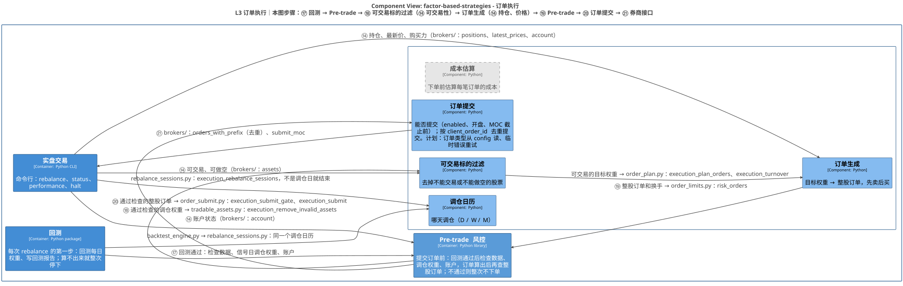
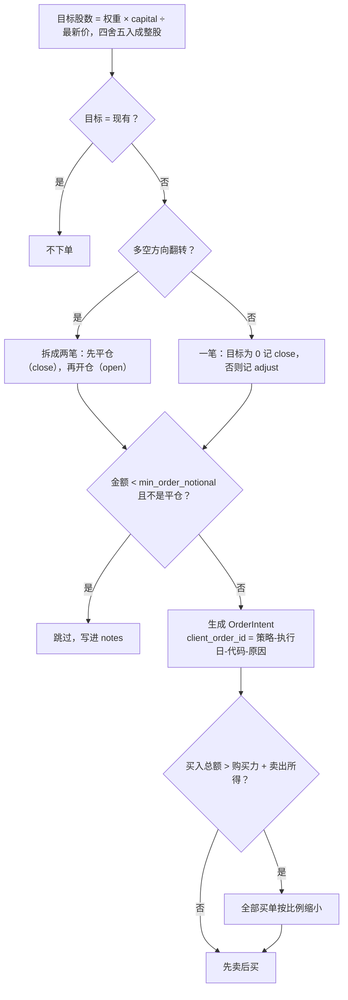

# fbs.execution：执行（C4 L3 + L4）

执行回答一个问题：**通过风控的目标权重，怎么变成订单并且提交？** 它从不改目标权重，只决定怎么下单、什么时候下。改权重是 [fbs.risk](../risk/README.md) 的事。

**执行方法**：全部用收盘市价单（MOC），在执行日 t+1 的收盘集合竞价成交，成交价就是回测假设的收盘价，所以执行时点本身几乎不带来滑点。订单类型现在写死在各券商适配器（[brokers/](../live/brokers/__init__.py)）的 `submit_moc` 里，计划改成从 config 读（§5.15 第 2 步）。

它是共享库，自己不运行；只有 `order_submit.py` 接触券商（runner 把券商对象传进来）。由 [fbs.live](../live/README.md) 调用，`rebalance_sessions.py` 也被 [fbs.backtesting](../backtesting/README.md) 用来保证回测按同一个调仓日历。设计和决定见 [architecture_new.md §5.15](../../../architecture_new.md)。

## L3 组件

灰色虚线框是计划中的文件，还没写。

## L4 函数

| 顺序 | 文件 | 函数 | 做什么 |
| --- | --- | --- | --- |
| ① 第 2 步 | [rebalance_sessions.py](rebalance_sessions.py) | `execution_rebalance_sessions(sessions, rule)` | D：每个交易日；W：每周最后一个交易日；M：每月最后一个交易日（遇到节假日自动往前挪） |
| ② 第 6 步 | [tradable_assets.py](tradable_assets.py) | `execution_remove_invalid_assets(weights, assets, allow_shorts)` | 去掉 NaN 和极小权重（< 1e-6）；券商不能交易的股票目标设为 0；不允许做空或借不到券的空头目标设为 0。每去掉一只都写进 `notes` |
| ③ 第 6 步 | [order_plan.py](order_plan.py) | `execution_plan_orders(...)` | 见下面的规则 |
| ④ 第 6 步 | [order_plan.py](order_plan.py) | `execution_turnover(orders, prices, capital)` | 单边换手 = 成交额 ÷ capital ÷ 2，交给 pre-trade 的 `risk_orders` 检查 |
| ⑤ 第 8 步 | [order_submit.py](order_submit.py) | `execution_submit_gate(paper, clock)` | 不能提交的原因：`paper.enabled` 是 false、市场没开、离收盘不到 `moc_cutoff_minutes` |
| ⑥ 第 8 步 | [order_submit.py](order_submit.py) | `execution_submit(broker, orders, prefix, since)` | 逐笔提交收盘市价单；本执行日已经发过的（同一个 `client_order_id`）跳过，一笔被拒不影响其他 |

`execution_plan_orders` 的规则（详见 architecture_new.md §5.4）：

## 计划中（§5.15 第 2、3、5 步）

| 文件 | 函数 | 做什么 |
| --- | --- | --- |
| order_submit.py | `execution_submit` | 订单类型从 config 读；遇到 429 或 5xx 自动重试，业务性拒单不重试 |
| cost_estimate.py | `execution_estimate_costs` | 下单前按成本模型估算每笔订单的成本，和实际滑点一起写进记录 |
