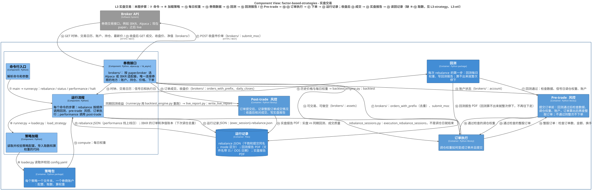
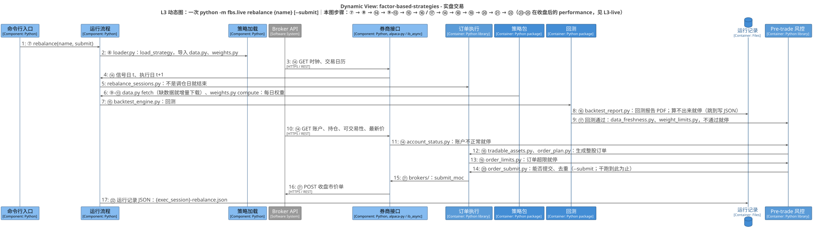
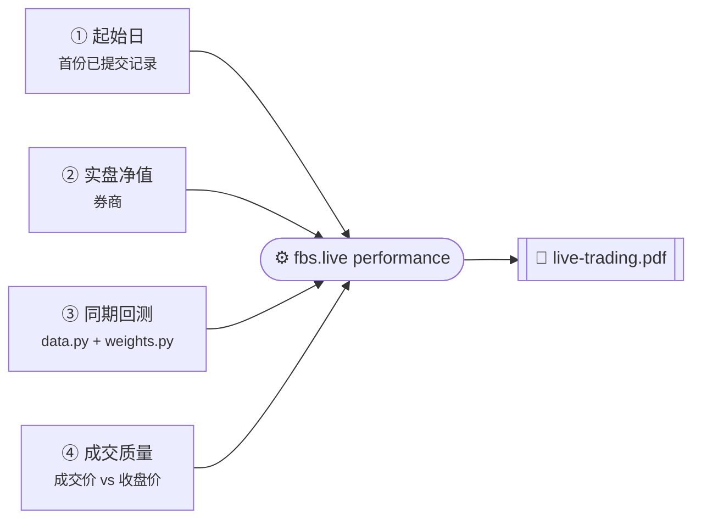
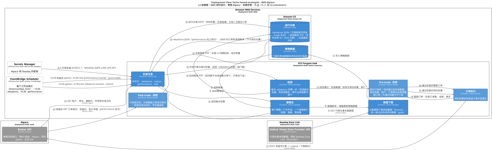
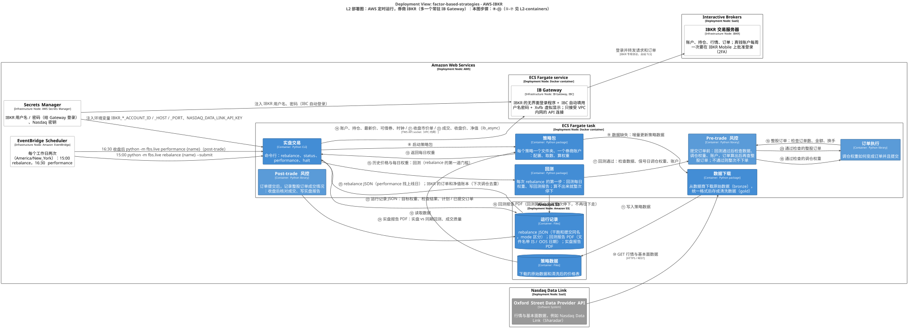

# fbs.live：实盘交易（C4 L3）

入口是 `python -m fbs.live 命令 策略名`（[__main__.py](__main__.py)）。上级架构图（L1、L2）见 [根目录 README](../../../README.md#架构c4)。

| 命令 | 选项 | 做什么 |
| --- | --- | --- |
| `rebalance` | `--submit`、`--asof YYYY-MM-DD`、`--force` | 先回测并写回测报告 PDF（回测跑不出来就整次停下），再做 pre-trade 风控、算计划订单，写运行记录 JSON。默认干跑，不下单；`--submit` 提交到 `paper.broker` 的 paper 账户；`--asof` 用过去某个信号日干跑；`--force` 不是调仓日也照跑 |
| `status` | — | 账户、持仓和最近的订单 |
| `performance` | `--start YYYY-MM-DD` | **Post-trade，收盘后定时运行**：核对成交，写实盘报告 PDF 到 `records/`（实盘和同期回测对比、成交质量，见第 3 节） |
| `halt` | — | 撤销全部未成交订单 |
| `flatten` | `--yes`（必填） | 撤单并清空全部持仓 |

图由 [docs/C4_Architecture/workspace.dsl](../../../docs/C4_Architecture/workspace.dsl) 生成，改图请改这个文件，然后运行 `make diagrams`。

## 1. 组件（L3）



| 文件 | 职责 |
| --- | --- |
| [__main__.py](__main__.py) | 命令行入口，解析参数后调用 runner |
| [runner.py](runner.py) | 每个命令的步骤；rebalance 按顺序调用 [fbs.backtesting](../backtesting/README.md)、[fbs.risk](../risk/README.md) pre_trade 和 [fbs.execution](../execution/README.md)，performance 调用 fbs.risk post_trade |
| [loader.py](loader.py) | 读取并校验 `strategy/{name}/config.yaml`，导入策略的 `data.py` 和 `weights.py` |
| [brokers/](brokers/__init__.py) | **唯一连接券商的地方**，按 config.yaml `paper.broker` 选一个：账户、持仓、价格、下单、净值和成交都通过它（见第 5 节） |
| [brokers/base.py](brokers/base.py) | 所有券商共用的记录（`OrderIntent`、`AccountState`、`AssetInfo`、`MarketClock`、`OrderRecord`）和 `Broker` 接口；runner、fbs.execution、fbs.risk 只认这些 |
| [brokers/alpaca.py](brokers/alpaca.py) | `AlpacaBroker`：Alpaca paper，REST（alpaca-py） |
| [brokers/ibkr.py](brokers/ibkr.py) | `IBKRBroker`：IBKR paper，经 TWS / IB Gateway（ib_async） |

## 2. 一次 rebalance（动态图）



`rebalance` 由 `runner.py` 的 `rebalance` 依次执行（L4）：

| 步骤 | 文件 | 函数 | 做什么 |
| --- | --- | --- | --- |
| 0 | loader.py | `load_strategy` | 读 config.yaml（含 paper 块），检查必填字段，导入 data.py 和 weights.py |
| 1 | runner.py、brokers/ | `_pick_sessions`、`clock`、`sessions` | 读券商时钟和交易日历（Alpaca `/v2/clock`、`/v2/calendar`；IBKR 用 NYSE 日历），定出信号日 t 和执行日 t+1 |
| 2 | fbs/execution/rebalance_sessions.py | `execution_rebalance_sessions` | 信号日不是调仓日（按 config.yaml `rebalance`）就结束；`--submit` 下周末和节假日也结束 |
| 3 | 策略的 data.py、weights.py | `_strategy_weights`：`fetch`、`compute` | 下载最近 lookback_sessions 天的数据，算出每个交易日的权重 |
| 4 | fbs/backtesting/backtest_engine.py、backtest_report.py | `_backtest_gate`：`backtest`、`write_backtest_report` | **回测门槛**：从 config.yaml `backtest_start`（没有就用本次数据）回测到信号日，写回测报告 PDF。回测算不出来（没有权重、不到 2 个持仓日）或 PDF 写不出来就整次停下 |
| 5 | fbs/risk/pre_trade/data_freshness.py、weight_limits.py | `_signal_weights`：`risk_input_data`、`risk_weights` | 取信号日那一行非零权重；数据不新鲜或权重超限就停 |
| 6 | brokers/；fbs/risk/pre_trade/account_status.py、order_limits.py；fbs/execution/tradable_assets.py、order_plan.py | `_plan`：`risk_account`、`execution_remove_invalid_assets`、`execution_plan_orders`、`execution_turnover`；然后 `risk_orders` | 读账户、持仓、每只股票能否交易（`assets`）、最新成交价；账户不正常就停；去掉不能交易的股票，算出整股买卖数量（先卖后买）；订单数、金额、换手超限就停 |
| 7 | runner.py | `_write_record` | **dry run**（不加 --submit）或被拦下：写运行记录 JSON，不下单 |
| 8 | fbs/execution/order_submit.py、brokers/ | `execution_submit_gate`、`execution_submit`、`submit_moc` | **paper trading**（--submit）：确认 paper.enabled、市场开盘、离收盘超过 moc_cutoff_minutes；`orders_with_prefix` 跳过今天已发过的订单，再用 `submit_moc` 逐笔提交收盘市价单，然后写运行记录 JSON。**live trading**（真实资金）暂不实现 |

每次运行（包括被拦下的）都写一条运行记录 JSON；回测通过时还有一份回测报告 PDF。dry run 和 --submit 写的文件名相同：运行记录 `records/执行日-rebalance.json`（里面的 `mode` 区分干跑和提交，`backtest_report` 指向同一次的回测报告），回测报告 `records/执行日-backtest_IS-起止_OOS-起止.pdf`（没有 split 时是 `_FULL-起止`）。文件名带 IS / OOS 日期，换一种样本划分重跑会另存一份。干跑不会覆盖同一执行日已经提交（submitted / partial）的记录。回测报告只有历史回测；当天的目标权重、检查结果和订单在 JSON 里。

成交核对（post-trade）不在 rebalance 里：收盘市价单在收盘时才成交，那时这次运行已经结束。它由收盘后的 `performance` 完成（第 3 节）。

运行记录 JSON（同一执行日再跑会覆盖）：

```json
{
  "strategy": "strategy_example",
  "mode": "dry_run",                 // dry_run 或 submit
  "signal_session": "2026-10-30",    // 信号日 t
  "exec_session": "2026-11-02",      // 执行日 t+1
  "run_at": "2026-11-17T18:42:37-05:00",
  "status": "dry_run",               // dry_run / blocked / submitted / partial（有订单被拒）
  "failures": [],                    // 没通过的风控检查，非空即不下单
  "notes": [],                       // 去掉的股票、跳过的小额交易等
  "targets": {"AAPL": 0.095},        // 信号日的非零目标权重
  "orders": [{"symbol": "AAPL", "side": "buy", "qty": 27, "target_weight": 0.095,
              "client_order_id": "strategy_example-2026-11-02-AAPL-adjust", "reason": "adjust"}],
  "submitted": [],                   // --submit：每个订单的 client_order_id 和提交结果
  "turnover": 0.4766                 // 本次换手率
}
```

## 3. Post-trade：收盘后核对成交（performance）



- **① 起始日**：`records/` 里最早一份已提交的 `-rebalance.json`，或用 `--start` 指定
- **② 实盘净值**：券商的账户净值历史（Alpaca portfolio history；IBKR 读 `records/ibkr-equity.csv`，见第 5 节），每日变化 ÷ `paper.capital`
- **③ 同期回测**：用同一套 data.py + weights.py 从起始日重跑到今天（[fbs.backtesting](../backtesting/README.md)）
- **④ 成交质量**：GET 本策略订单和每日收盘价，对比成交价与收盘价（[fbs.risk.post_trade](../risk/README.md) 的 `risk_fills`）

PDF 由 `fbs/risk/post_trade/live_report.py` 的 `write_live_report` 写。上线后每个交易日收盘后定时运行一次（第 4 节），也可以在本机手动运行。

| PDF | 谁生成 | 何时 | 内容 |
| --- | --- | --- | --- |
| `执行日-backtest_IS-起止_OOS-起止.pdf` | rebalance 第 4 步（fbs.backtesting） | 每次运行，风控和下单之前 | 回测报告：历史回测（IS / Embargo / OOS） |
| `最后交易日-live-trading.pdf` | performance（fbs.risk.post_trade） | 上线后每个交易日收盘后 | 实盘报告：实盘收益 vs 同期回测、成交质量 |

## 4. 部署：AWS 定时运行

两个券商的部署不一样，各画了一张图。下面的触发、数据、重复运行两家相同；密钥和 IBKR 额外要求按券商分开。

**Alpaca**（`paper.broker: alpaca`）：只有一个临时任务，交易日之间 AWS 上什么都不运行。



**IBKR**（`paper.broker: ibkr`）：多一个常驻的 IB Gateway 服务，runner 在 VPC 内网连它，由它转发到 IBKR。



- **触发**：EventBridge Scheduler 每个工作日启动两次 ECS Fargate 任务：15:00（America/New_York）运行 `rebalance --submit`；16:30 收盘后运行 `performance`（post-trade：核对当天的成交，写实盘报告）。rebalance 不按调仓频率分别设 cron。原因是 cron 表达不了"每月 / 每周最后一个交易日"（遇到节假日会错开），所以由第 2 步按 config.yaml 的 `rebalance` 判断：不是调仓日就直接结束。15:00 离收盘还有 60 分钟，留出下载数据的时间，也远早于 `paper.moc_cutoff_minutes`
- **数据**：Fargate 任务的磁盘在任务结束后清空，所以 `data/` 和 `records/` 长期存在 S3：① 任务开始时从 S3 下载 `data/` 到容器磁盘里的 `strategy/策略名/` 下（rebalance 只写 records/、不读，所以不用下载）；② runner 像在本机一样运行；③ runner 结束后（无论下单成功、被拦下还是报错）把 `data/` 和本次新写的 `records/` 上传回 S3，下次运行 data.py 仍然只增量下载。16:30 的 performance 任务开始时还要从 S3 下载 records/（它读已提交的 -rebalance.json）；在本机跑 performance 前也一样
- **密钥**：存在 Secrets Manager，作为环境变量注入，不用 .env。Alpaca：`ALPACA_账户名_KEY / _SECRET` 注入任务。IBKR：`IBKR_账户名_ACCOUNT_ID / _HOST / _PORT` 注入任务（`_HOST` 是 Gateway 服务的内网地址），IBKR 用户名、密码注入 Gateway 服务。两家都要注入 `NASDAQ_DATA_LINK_API_KEY`
- **重复运行**：同一执行日跑两次不会重复下单（订单的 `client_order_id` 相同，已发出的会跳过）
- **IBKR 额外要求**：
  - **常驻 Gateway**：一个 ECS 服务（desired count = 1）运行 IB Gateway + IBC 镜像，一直保持登录；每天自动重启的时间设在收盘后，避开 15:00 的运行。Gateway 只放行 VPC 内网连接，不暴露公网
  - **账本同步**：任务开始时还要从 S3 下载 `records/ibkr-orders.json` 和 `records/ibkr-equity.csv`，结束时上传。IBKRBroker 靠它们去重和算净值，丢了会重复下单或缺净值
  - **登录**：Gateway 没登录时 runner 连不上，会报错退出、不下单。paper 账户一般没有两步验证；真钱账户大约每周要在 IBKR Mobile 上批准一次登录（见第 5 节）

## 5. 券商：Alpaca 和 IBKR

config.yaml 里 `paper.broker: alpaca`（默认）或 `ibkr`。runner 通过 `make_broker` 拿到券商对象，只调用 [brokers/base.py](brokers/base.py) 里 `Broker` 接口的方法，所以换券商不用改 runner、fbs.execution 和 fbs.risk。新增券商：在 `brokers/` 下加一个实现同样方法的文件，再在 `make_broker` 和 `BROKERS` 里登记。

| | Alpaca | IBKR |
| --- | --- | --- |
| 连接 | REST，直接调用 | 先运行 TWS 或 IB Gateway 并登录 paper 账户，ib_async 走本机 socket |
| 账户配置（环境变量或 .env） | `ALPACA_账户名_KEY`、`_SECRET` | `IBKR_账户名_ACCOUNT_ID`（必填，DU 开头）；可选 `_HOST`（127.0.0.1）、`_PORT`（4002 = Gateway paper，TWS paper 是 7497）、`_CLIENT_ID`（1）、`_MARKET_DATA_TYPE`（3 = 有实时订阅用实时，否则 15 分钟延迟） |
| 只做 paper 的保护 | 客户端必须指向 `paper-api.alpaca.markets` | 账户号必须 DU / DF 开头，且 Gateway 登录的所有账户都必须是 paper 账户，否则拒绝连接 |
| 时钟、交易日历 | Alpaca `/v2/clock`、`/v2/calendar` | 没有这类接口：用 exchange_calendars 的 NYSE 日历（含提前收盘），时间取 Gateway 的服务器时间 |
| 收盘市价单 | `time_in_force=cls` | `orderType=MOC`，`client_order_id` 写在 `orderRef` |
| 不重复下单 | Alpaca 保证 `client_order_id` 唯一 | IBKR 不保证 `orderRef` 唯一，而且几天后就查不到已完成的订单，所以每笔订单**发送前**先写进 `records/ibkr-orders.json`，再跑时这里或 IBKR 有同一个 id 就跳过 |
| 每日净值（performance 用） | Alpaca portfolio history | API 没有净值历史：每次在交易日开盘后连接时，把上一交易日收盘净值（`PreviousDayEquityWithLoanValue`）记进 `records/ibkr-equity.csv`，收盘后连接再记当天的 `NetLiquidation`。每个交易日都有定时任务连接，所以不缺天；漏掉的日子在 performance 里就没有实盘收益 |
| 能否做空 | Alpaca `shortable`、`easy_to_borrow` | 行情 tick 236（可借券情况），需要行情权限 |
| 成交对比用的收盘价 | SIP 日线，不复权 | IBKR TRADES 日线（拆股复权、不含分红） |
| 账户状态 | `ACTIVE`、交易 / 账户冻结标志 | API 没有这些字段：连上 paper 账户即视为正常 |
| 代码写法 | `BRK.B` | 自动转换成 `BRK B` |

IBKR 第一次使用：
1. 在 IBKR 账户管理里开 paper 账户，记下 DU 开头的账户号
2. 运行 IB Gateway（或 TWS），用 paper 账户登录；在 Configure → API → Settings 里勾选 Enable ActiveX and Socket Clients，取消 Read-Only API，端口与 `IBKR_账户名_PORT` 一致
3. .env 里加 `IBKR_账户名_ACCOUNT_ID=DU...`，config.yaml 改 `paper.broker: ibkr`
4. 先跑 `status`，再跑一次 dry run 的 `rebalance`，核对价格和订单后再 `--submit`

IB Gateway 每天会自动重启，每周需要重新登录（paper 账户一般不需要两步验证）；无人值守部署通常用 IBC 自动登录。
