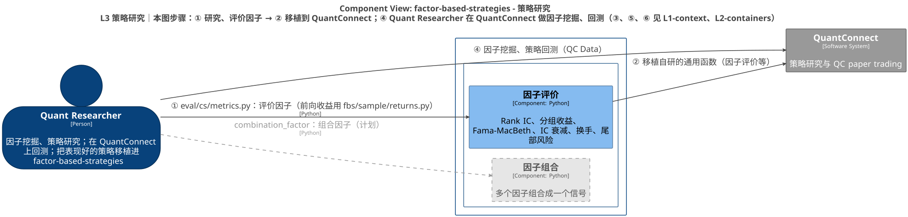

# fbs.research：策略研究（C4 L3）

策略研究会用到的函数，只在研究阶段使用，实盘交易不调用。上级架构图（L1、L2）见 [根目录 README](../../../README.md#架构c4)。

| 文件夹 | 内容 | 函数表（L4） |
| --- | --- | --- |
| [eval/](eval/) | 因子评价：Rank IC、分组收益、Fama-MacBeth、IC 衰减、换手、尾部风险 | [eval/README.md](eval/README.md) |
| [combination_factor/](combination_factor/) | 因子组合，暂时是空的 | — |
