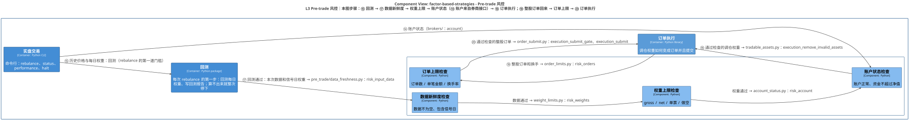
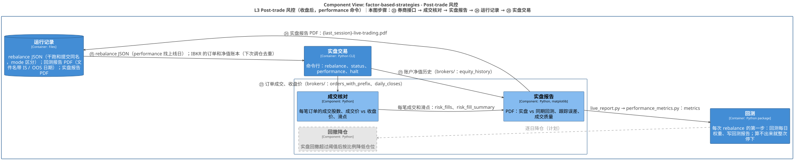

# fbs.risk：风控（C4 L3 + L4）

风控回答两个问题：下单前，**这次调仓允许长什么样？** 下单后，**订单成交得怎么样？** 下单前的每个函数读 config.yaml `paper.limits` 里的上限，返回一个失败原因列表。只要有一条失败，runner 就**整次不下单**，失败原因写进运行记录 JSON 的 `failures`。所以坏数据、代码 bug 或者不正常的账户都不会变成真实订单。

按订单是否已经提交分成两块：

| 子包 | 什么时候跑 | 检查什么 | L2 箭头 |
| --- | --- | --- | --- |
| [pre_trade/](pre_trade/) | 回测通过之后、**提交订单之前**（rebalance 第 5、6 步） | 数据、调仓权重、账户；订单执行算出整股订单后，再查订单数、金额、换手 | ⑰ 回测 → Pre-trade 风控，⑱ → 订单执行，⑲ 整股订单回来检查，⑳ → 订单执行 |
| [post_trade/](post_trade/) | **收盘后**（performance 命令） | 每笔订单的成交、成交价 vs 收盘价；写实盘报告 PDF。计划：按实盘回撤降仓 | ㉓ 券商 → Post-trade 风控，㉔ 实盘报告 PDF → 运行记录 |

它是共享库，自己不运行。pre_trade 全部是纯函数；post_trade 的 `fills.py` 是纯函数，`live_report.py` 写 PDF（要 matplotlib）。检查函数都可以直接 `from fbs.risk import ...`。现在由 [fbs.live](../live/README.md) 调用；等 adjust 和回撤降仓做好后，[fbs.backtesting](../backtesting/README.md) 也要调用同一套函数，回测才和实盘一致。设计和决定见 [architecture_new.md §5.15](../../../architecture_new.md)。

## L3 组件

灰色虚线框是计划中的文件，还没写。

## L4 函数

按 runner 的调用顺序：

| 顺序 | 文件 | 函数 | 输入 | 读取的 config | 不通过时 |
| --- | --- | --- | --- | --- | --- |
| ① 第 5 步，回测通过后 | [pre_trade/data_freshness.py](pre_trade/data_freshness.py) | `risk_input_data(data, signal_session)` | data.fetch 的输出、信号日 | — | 数据为空，或最后一行不是信号日（数据源还没更新）→ 停 |
| ② 第 5 步 | [pre_trade/weight_limits.py](pre_trade/weight_limits.py) | `risk_weights(weights, limits)` | 信号日的目标权重 | `max_gross`、`max_net`、`max_weight`、`allow_shorts` | 有 inf；Σ\|w\| > max_gross；\|Σw\| > max_net；单票 \|w\| > max_weight；不允许做空却有负权重 → 停 |
| ③ 第 6 步，读账户后 | [pre_trade/account_status.py](pre_trade/account_status.py) | `risk_account(account, capital)` | 券商账户状态（`AccountState`） | `paper.capital` | 账户不是 active、被冻结，或 capital > 账户净值 → 停 |
| ④ 第 6 步，订单执行算出订单后 | [pre_trade/order_limits.py](pre_trade/order_limits.py) | `risk_orders(orders, prices, turnover, limits)` | 计划订单、最新价、换手率 | `max_orders`、`max_order_notional`、`max_turnover` | 订单数超限、单笔金额超限、单边换手超限 → 停 |

收盘后（performance 命令）：

| 文件 | 函数 | 做什么 |
| --- | --- | --- |
| [post_trade/fills.py](post_trade/fills.py) | `risk_fills(orders, closes, name)` | 每笔订单一行：下单股数、成交股数、成交价、当天收盘价、滑点（正数 = 比收盘价差） |
| [post_trade/fills.py](post_trade/fills.py) | `risk_fill_summary(ex)` | 订单数、全部成交 / 没全部成交的笔数、按股数的成交率、按金额加权的滑点 |
| [post_trade/live_report.py](post_trade/live_report.py) | `write_live_report(path, strategy, info, cmp, ex)` | 实盘报告 PDF：第 1 页实盘 vs 同期回测，第 2 页跟踪误差和成交 |

## 计划中（§5.15 第 4 步）

| 文件 | 函数 | 做什么 |
| --- | --- | --- |
| pre_trade/weight_limits.py | `risk_adjust_weights` | 策略开启后，`max_weight` 超限就把单票裁到上限（多出的留作现金），`max_gross` 超限就按比例缩小全部权重，不再整次拦下。其他上限仍然一律拦下 |
| post_trade/drawdown.py | `risk_drawdown_scale` | 回撤 ≥ `threshold` 时全部权重乘以 `scale`，回撤回到 `resume` 以下才恢复；只在调仓日生效 |

新增的 config 字段见 architecture_new.md §5.15.6。
