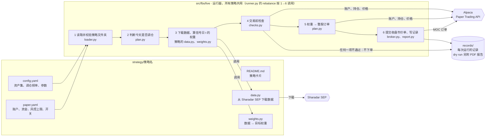

# Strategy 编写规范与 Alpaca Paper Trading

## 1. 架构



入口是 `python -m fbs.live rebalance 策略名`（`__main__.py`），由 `runner.py` 的 `rebalance` 依次执行：

| 步骤 | 文件 | 函数 | 做什么 |
| --- | --- | --- | --- |
| 1 | loader.py | `load_strategy` | 读 config.yaml、paper.yaml，检查必填字段，导入 data.py 和 weights.py |
| 2 | broker.py、plan.py | `sessions`、`rebalance_sessions` | 从 Alpaca 取交易日历，按 rebalance 判断信号日是不是调仓日，不是就结束 |
| 3 | 策略的 data.py、weights.py | `fetch`、`compute` | 下载最近 lookback_sessions 天的数据，取信号日那一行权重 |
| 4 | checks.py | `check_data`、`check_weights`、`check_account`、`check_orders` | 数据是否最新、权重是否超风控上限、账户是否正常；`check_orders` 在第 5 步算出订单后检查订单数、金额和换手率；任何一项不通过就不下单 |
| 5 | plan.py | `clean_targets`、`plan_orders`、`turnover` | 去掉不能交易的股票，按账户持仓和最新价算出整股买卖数量，先卖后买 |
| 6 | broker.py、runner.py、report.py | `submit_moc`、`_write_record`、`write_report` | 加 --submit 时提交收盘市价单；每次运行写 records/ 记录，dry run 另生成 PDF 报告 |

broker.py 是唯一连接 Alpaca 的文件，步骤 2、4、5、6 中的账户、持仓、价格和下单都通过它。

## 2. 新建一个策略

1. 复制 strategy_template 文件夹，改名为策略名（小写字母加下划线）
2. data.py：已写好，每次运行从 Sharadar SEP 下载 universe 的日线，存在 data/，一般不用改。
3. 按顺序修改 config.yaml（每项的含义见文件内注释）：

   | 顺序 | 参数 | 填什么 |
   | --- | --- | --- |
   | 1 | name | 与文件夹同名 |
   | 2 | universe | 可交易的股票代码 |
   | 3 | rebalance | D 每天 / W 每周最后一个交易日 / M 每月最后一个交易日 |
   | 4 | lookback_sessions | 信号最长窗口 + 余量 |
   | 5 | backtest_start | PDF 报告的回测起始日 |
   | 6 | params | weights.py 用到的全部参数 |
   | 7 | data.field | 传给 weights.py 的价格列，常用 close_adj |

4. 写 weights.py 的 compute，见第 3 节
5. 干跑：`python -m fbs.live rebalance 策略名 --asof YYYY-MM-DD`，不下单，在 records/ 生成 JSON 记录和 PDF 报告（目标权重、计划订单、检查结果、回测曲线与指标）；--asof 填过去的一个调仓日
6. 填写策略卡片 README.md，结论引用最新的 PDF 报告
7. 上 paper trading 前按顺序修改 paper.yaml：

   | 顺序 | 参数 | 填什么 |
   | --- | --- | --- |
   | 1 | account | Alpaca paper 账户名，.env 中填 ALPACA_账户名_KEY / _SECRET |
   | 2 | capital | 策略资金，不超过账户净值 |
   | 3 | limits | 风控上限，参考 PDF 报告中的换手率和持仓再留余量 |
   | 4 | enabled | 先保持 false；干跑核对无误后改为 true |

## 3. weights.py：怎么写 compute

```python
def compute(data: pd.DataFrame, params: dict) -> pd.DataFrame:
```

| | 内容 |
| --- | --- |
| 输入 data | data.py 的输出：行是交易日（升序），列是 universe 的股票代码，值是 data.field（如 close_adj） |
| 输入 params | config.yaml 的 params，参数一律从这里取，不写死在代码里 |
| 输出 | 与 data 相同的行和列，值是目标权重 = 占策略资金的比例；做多为正、做空为负、不持有为 0 |

按四步写：

1. 信号：每只股票每天一个分数，例如 `data.shift(skip) / data.shift(lookback) - 1`
2. 有效条件：去掉当天无价格或历史不够长的股票，例如 `signal.where(data.notna())`
3. 选股：按分数排名选出要持有的股票，例如 `signal.rank(axis=1, ascending=False) <= top_n`
4. 权重：给选中的股票分配权重，例如等权 `selected / selected.sum(axis=1) * gross`，最后 `fillna(0)`

规则：

- 第 t 行只能用 t 日收盘及以前的数据：只用 shift、rolling 等向后看的运算，不用全样本均值、标准化或未来数据
- 每一行都要算：回测用全部行，paper trading 只取信号日那一行；运行器只在 rebalance 指定的日子下单
- 权重绝对值之和不超过 paper.yaml 的 max_gross，单只不超过 max_weight；建议留 3%–5% 现金吸收整股取整误差
- 完整示例见 strategy_example/weights.py
