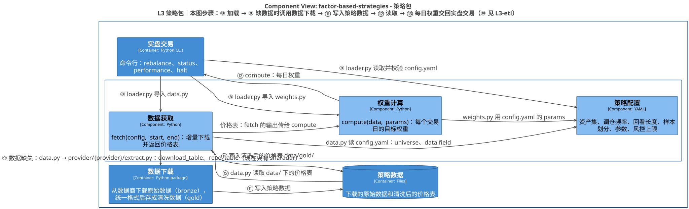

# strategy：策略包（C4 L3）

## 1. 组件（L3）

一个策略文件夹 `strategy/{name}/` 是一个 C4 container：[fbs.live](../src/fbs/live/README.md) 加载它，回测用同一个 `weights.py`；它通过 [fbs.etl](../src/fbs/etl/README.md) 下载数据。上级架构图（L1、L2）见 [根目录 README](../README.md#架构c4)；一次 rebalance 怎么跑、AWS 定时运行和上线后评估，见 [src/fbs/live/README.md](../src/fbs/live/README.md)。

| 文件 | 谁读 / 谁调用 | 做什么 |
| --- | --- | --- |
| `config.yaml` | loader.py 校验；data.py 读 universe 和 data.field；runner 把 params 传给 weights.py；[fbs.risk](../src/fbs/risk/README.md) 读 paper.limits | 资产集、调仓频率、回看长度、样本划分、params、paper trading 设置和风控上限 |
| `data.py` | runner 调用 `fetch(config, start, end)` | 调 fbs.etl 增量下载 bronze，合并成自己的 gold，都在 `data/` 下；返回价格表（每只股票一列） |
| `weights.py` | runner 调用 `compute(data, params)`；回测用同一个函数 | 每个交易日的目标权重 |
| `data/` | data.py 读写 | 下载的数据，不提交到 git；AWS 上长期存在 S3 |
| `records/` | fbs.live 写 | 每次运行的 JSON 和 PDF |
| `README.md` | 人读 | 策略假设、参数含义、已知局限 |

## 2. 新建一个策略

1. 复制 strategy_template 文件夹，改名为策略名（小写字母加下划线）；策略名就是文件夹名，命令行里也用它
2. data.py：已写好，一般不用改。universe 的 Sharadar SEP 日线保存在策略自己的 data/（不提交到 git）：第一次运行下载全部历史，之后每次只增量下载新的交易日和被修订（拆股、分红调整）的历史行；删掉 data/sync_state.json 可重新全量下载，详见 data/README.md
3. 按顺序修改 config.yaml 的研究部分（每项的含义见文件内注释；策略只有这一个配置文件）：

   | 顺序 | 参数 | 填什么 |
   | --- | --- | --- |
   | 1 | universe | 可交易的股票代码 |
   | 2 | rebalance | D 每天 / W 每周最后一个交易日 / M 每月最后一个交易日 |
   | 3 | lookback_sessions | 因子需要数据最长窗口 + 余量 |
   | 4 | backtest_start | 回测报告的回测起始日 |
   | 5 | split | 样本划分：is_end 是 IS 最后一天，embargo_sessions 是 Embargo 的交易日数（不短于一个调仓周期：D 1 / W 5 / M 21），之后是 OOS |
   | 6 | params | weights.py 用到的全部参数，只按 IS 的结果选，不按 OOS 改 |
   | 7 | data.field | 传给 weights.py 的价格列，常用 close_adj |

4. 写 weights.py：

   按四步写，每步写一行注释、一两行代码（完整示例见 strategy_example/weights.py）：

   1. 信号：每只股票每天一个分数，例如 `signal = data.shift(skip) / data.shift(lookback) - 1`
   2. 有效条件：去掉当天无价格或历史不够长的股票，例如 `eligible_signal = signal.where(data.notna())`
   3. 选股：按分数排名选出要持有的股票，例如 `selected_asset = eligible_signal.rank(axis=1, ascending=False) <= top_n`
   4. 权重：给选中的股票分配权重，例如等权 `selected_asset_rebalance_weights = selected_asset.div(selected_asset.sum(axis=1), axis=0) * gross`，最后 `fillna(0.0)`

5. 干跑前按顺序修改 config.yaml 的 paper 块：

   | 顺序 | 参数 | 填什么 |
   | --- | --- | --- |
   | 1 | paper.account | Alpaca paper 账户名，.env 中填 ALPACA_账户名_KEY / _SECRET |
   | 2 | paper.capital | 策略资金，不超过账户净值 |
   | 3 | paper.limits | 风控上限；先按策略设计填一个初值，第 7 步再按 回测报告收紧 |
   | 4 | paper.enabled | 保持 false，第 7 步再改 |

6. 干跑：`python -m fbs.live rebalance 策略名 --asof YYYY-MM-DD`，结果看 records/ 里的 回测报告；策略卡片 README.md 只写策略设定（研究问题到样本划分），不写任何干跑或 paper trading 结果

   > 干跑和 paper trading 的区别：两者都走完 [一次 rebalance](../src/fbs/live/README.md#2-一次-rebalance动态图) 的第 0→5 步（读真实的 paper 账户、算出真实订单、做全部检查），区别只在第 6 步。
   > - 干跑（不加 `--submit`）：不下单，只写 records/ 记录和 回测报告（计划订单 + 回测），可用 `--asof` 指定任意信号日，随时可跑，用来在上线前检查策略和配置
   > - paper trading（加 `--submit`）：要求 `paper.enabled: true`、市场开盘且离收盘超过 `moc_cutoff_minutes`，把订单作为收盘市价单真正提交到 Alpaca paper 账户（模拟资金，不涉及真钱），之后可用 `performance` 对比实盘与回测

7. 核对 回测报告：按报告里的换手率和持仓收紧 paper.limits 并留余量，再干跑一次确认全部检查通过；无误后把 paper.enabled 改为 true
8. 上线：把策略的 data/、records/ 上传到 S3，为策略建一个 EventBridge Scheduler 定时任务（见 [部署：AWS 定时运行](../src/fbs/live/README.md#4-部署aws-定时运行)），任务每个工作日运行 `python -m fbs.live rebalance 策略名 --submit`，非调仓日自动跳过
9. 上线后每个交易日收盘后定时运行 `python -m fbs.live performance 策略名`（post-trade），读实盘报告：实盘与回测的差距、滑点和成交率，据此修订策略
